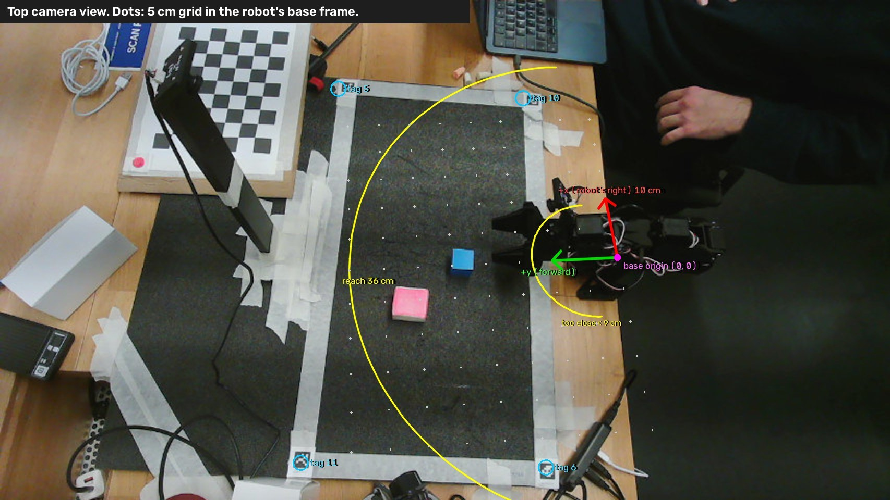

# elrobot-agent

Agent control for the ElRobot arm (seven joints and a parallel gripper, Feetech ST3215 servos) on top of the
NormaCore Station. An AI agent is started in `workspace/` and operates the arm with the Python tools there:
it sees the table through a camera above the mat and one on the wrist, plans in Python it can read and change,
and sends the robot one thing only, joint commands.



## What it does

- Finds, tracks, picks, places and stacks objects on the table; a pick can be checked by the wrist camera
  before and after (`pick_verified`). Run on the real arm.
- Recovers by itself: aims again when an object is moved, tries again when a grasp comes up empty, and sends a
  move that was stopped as blocked once more, slower.
- Chess against a person, drawing with a pen, and grasp planning among neighbours: in the simulator so far.
- A web UI, an MCP server and a voice agent on the same daemon.

`docs/FEATURES.md` says how far each part is proven.

## Run it

```bash
pixi run sim                    # simulated arm, no hardware
cd workspace && claude          # or any coding agent; it reads AGENTS.md
```

For the real arm: build the Station (see `CLAUDE.md`), then `scripts/cameras_ready.sh` and `pixi run up`.

```bash
uv run --with pytest pytest tests -q                       # simulator tests, about 5 minutes
(cd workspace && uv run --with pytest pytest -q tests)     # workspace code against a faked daemon, under a second
```

## Where to read

| Question | File |
|---|---|
| What can it do, and how far is each part proven? | `docs/FEATURES.md` |
| Why is it built this way? | `docs/DECISIONS.md` |
| Tools, joint commands, files, frames, units | `docs/INTERFACE.md` |
| The daemon's HTTP and WebSocket API | `docs/API.md` |
| How an agent operates the arm | `workspace/AGENTS.md`, `workspace/skills/` |
| Current state and next steps | `docs/HANDOFF.md`, `docs/PLAN.md` |

## Layout

`workspace/` is the agent's working directory (tools, skills, robot model, live perception, call history).
`src/elrobot/` is the robot side: the daemon that owns the arm, the servo link, kinematics and the simulator.
`station/` is the NormaCore Station config, `scripts/` bring-up and calibration helpers, `web/` the UI.
