# One contract, any agent: a code-as-policy harness for two robot arms

An AI coding agent operates a robot arm from a folder of Python tools. The agent does not output joint
angles. The agent writes and runs Python, and the Python sends joint commands. This is code as policy.

We built it at the HackLab Robotics x BRISA hackathon (NormaCore track, Berlin, 21 and 22 November 2026) for
the NormaCore ElRobot arm. On the second day we added an SO-101 arm to the same table.


| | |
|---|---|
| Arms | ElRobot (7 joints and a parallel gripper), SO-101 (5 joints and the same gripper) |
| Servos | Feetech ST3215, through the NormaCore Station |
| Cameras | top camera, one wrist camera on each arm, one Orbbec depth camera |
| Agents we used | Claude Code, Codex, pi |
| Interface to the robot | joint commands only |
| Chat | text and voice, in English, German and French |

## Contents

1. [The idea](#the-idea)
2. [Why code as policy](#why-code-as-policy)
3. [What we tried, in sequence](#what-we-tried-in-sequence)
4. [Results](#results)
5. [Zero-shot: the rubber ring](#zero-shot-the-rubber-ring)
6. [Recovery becomes a skill](#recovery-becomes-a-skill)
7. [What the agent sees](#what-the-agent-sees)
8. [Talk to the robot](#talk-to-the-robot)
9. [One demonstration, then the agent repeats it](#one-demonstration-then-the-agent-repeats-it)
10. [Ablations](#ablations)
11. [Two arms in one space](#two-arms-in-one-space)
12. [The SO-101 with a decision model](#the-so-101-with-a-decision-model)
13. [What did not work](#what-did-not-work)
14. [What we learned](#what-we-learned)
15. [Technology](#technology)
16. [Run it](#run-it)

## The idea

A robot arm understands joint angles. Thus the contract between the agent and the robot is only joint
angles. All other functions are Python code in the workspace. The agent can read this code, run it and
change it.

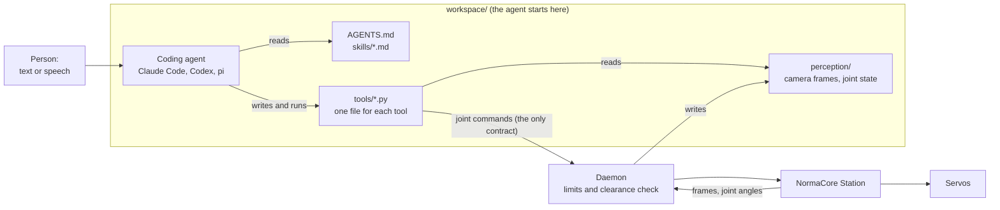

The full contract is one HTTP call:

```json
POST /api/joints
{"path": [[0.0, -0.37, -0.51, 0.63, 0.0, 1.28, 0.0]], "gripper": 0.5, "speed": 0.8}
```

The path is a list of joint angles in radians. Inverse kinematics, grasp planning, camera geometry and
collision checks are all on the agent side, in `workspace/tools/`.

A task then goes as follows:

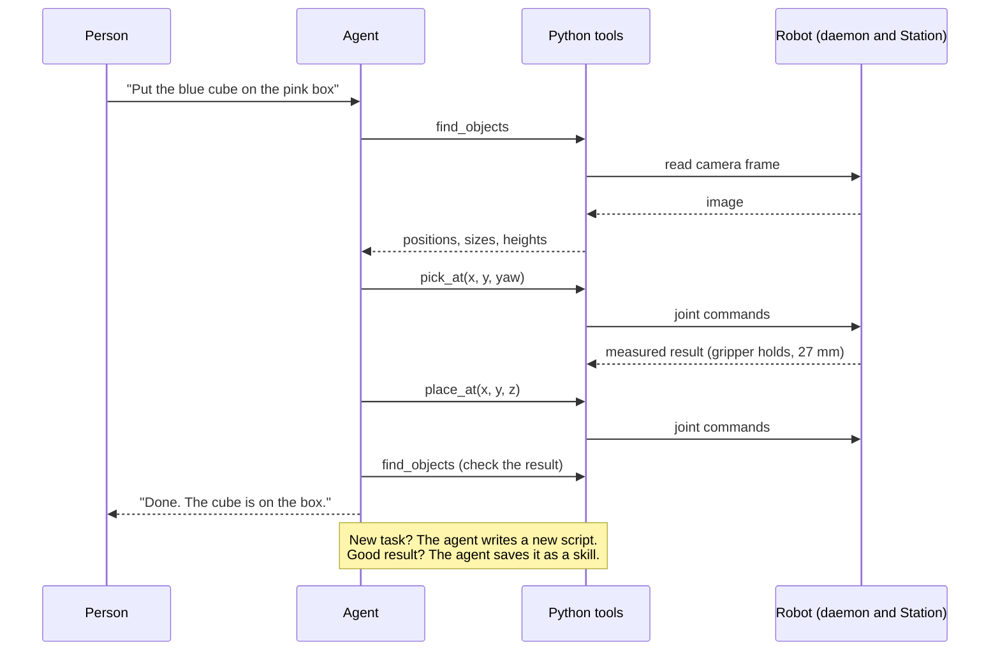

## Why code as policy

| | Code as policy (this harness) | A model that outputs actions directly (VLA, VLM) |
|---|---|---|
| What the model outputs | Python that calls tools | joint angles or tool-point waypoints |
| Same task, second time | the same script and the same commands | the model decides again |
| When a motion fails | the tool returns what it measured, and the agent changes the code | the model decides again from the new picture |
| New task | the agent writes a new script from the tools | a new prompt, or more training data |
| Where the knowledge goes | tools and skills, as files in the repository | model weights |
| Speed of one decision | seconds for each agent step | the decision model that we used: 1 to 3 decisions each second |
| Calibration | necessary (camera to robot) | not necessary for the wrist-camera approach that we used |

This table gives the design properties. It is not a measured comparison. The last two rows are the cost of
the harness. We used the two approaches; see [the SO-101 with a decision model](#the-so-101-with-a-decision-model).

## What we tried, in sequence

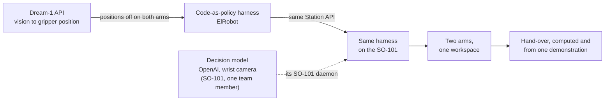

| Approach | What decides the motion | Result | Evidence |
|---|---|---|---|
| Dream-1 API (DreamLabs), used as vision to gripper position | the Dream-1 model gives the gripper position from the camera | The positions were off on both the ElRobot and the SO-101. We stopped. | team report; no measurements in this repository |
| Code-as-policy harness for the ElRobot | Python tools that the agent writes and runs | Pick, place, track and recover on the real arm | `docs/FEATURES.md`, tests |
| Decision model for the SO-101 (`autopilot` branch) | an OpenAI model, 1 to 3 decisions each second | It needs no camera-to-robot calibration step. Speed and cost: see the section below. | code on the `autopilot` branch; speed and cost are a team report |
| The harness with the SO-101 as a second arm | Python tools, as for the ElRobot | The SO-101 runs on the same NormaCore Station | `scripts/second_arm_up.sh`, `docs/SECOND_ARM.md` |
| Two arms in one workspace | the same, with a collision check for the two arms | The check refused the unsafe paths that we tested | `docs/RESULTS.md` |
| Hand-over of a cube | computed poses, then poses from one demonstration | 1 of the first 8 attempts worked, then 5 of the last 8 | run log in `docs/RESULTS.md` |

## Results

All numbers are from the real arms on 22 November 2026. The counts are small. We give each count.
Each number comes from a tool result or a test. Where a statement comes only from what the team saw, the text
says "team report".

| What | Result | Count |
|---|---|---|
| Pick and place of a 30 mm cube, ElRobot, with SAM 3 for the position | each grasp was clean | 3 of 3 |
| Place accuracy at 22 cm from the base | 4 mm from the commanded position | 1 |
| Place accuracy at 34 to 35 cm from the base | 8 mm and 12 mm | 2 |
| Pick with a wrist-camera check before and after (`pick_verified`) | the cube was in the jaws each time | 3 of 3 |
| Height of a 30 mm cube from the depth camera | 29 mm | 1 |
| Position from the depth camera compared with the top camera | 7 to 11 mm apart | 3 objects |
| Hand-over of a 30 mm cube, first 8 attempts | 1 worked | 1 of 8 |
| Hand-over of a 30 mm cube, last 8 attempts | 5 worked; in 1 of the 5 the tool reported an error after the cube had changed hands | 5 of 8 |
| Moves that the collision check refused | 4 were as intended; 2 were too strict, and we adjusted the rule | 6 |
| Stacking by the SO-101 | the cube landed adjacent to the base | 0 of 2 |
| Workspace tests | pass | 35 of 35 |
| Simulator tests | all pass but one push-T case (overlap 0.732; the test needs more than 0.75) | 1 failure |

`docs/RESULTS.md` has the pictures, the tables and the log of each run.

## Zero-shot: the rubber ring

The skill for pick and place had no text about rings. The standard pick tool aims at the centre of an
object, and the centre of a ring is a hole.

The agent got the task to pick the brown rubber ring and to put it down in a different position. The agent
did not use the standard pick tool. It read one point on the rim from the camera picture, and it put one
finger into the hole. Team report: this worked on the first attempt. The tool calls are in the call history
on the machine. They are not in this repository.

After the task, the agent added what it learned to the skill `workspace/skills/pick-and-place/SKILL.md`.
This text is in the repository:

> A ring wider than the jaws (the brown rubber one is about 9 cm across, wall about 23 mm) is picked by its
> rim, not by name: `pick_object` aims at the tracked centre, which is the hole. Read the ring's centre and
> one rim point to the robot's left or right of it off `capture_camera`, `pixel_to_table` the rim point, and
> `pick_at` there with `yaw_deg: 0`, `grasp_height: 0.02`: one finger goes down the hole.

The next agent that gets a ring reads this first. The same skill has a paragraph about a roll of tape, which
the agent picked the same way.

## Recovery becomes a skill

The tools return what the robot measured, not only "ok". Thus the agent can find the cause of a failure and
change the code.

| Failure | What the harness does | Where it is | Seen on |
|---|---|---|---|
| The jaws close on nothing | The tool reports it. The agent looks again and aims again. | `pick_at`, `pick_verified` | the real arm |
| A person moves the object during the reach | The tracker sees the motion. The pick aims at the new position. | `track_objects`, `pick_object` | the simulator; the real arm with the earlier top camera |
| The daemon stops a move as blocked | The move goes one more time at half speed. | `workspace/tools/util/arm.py` | tests only |
| The arm does not stop at the commanded pose | The tool reads the joints and corrects the pose. | `hand_over` | the real arms |
| The second arm closes on nothing | The first arm offers the object 1 cm further, then again. | `hand_over` | the real arms |
| A path goes through the other arm or through an object | The move is refused before it starts. The tool says which parts. | `util/shared_space.py` | the real arms |

When a new task works, `create_skill` writes the tool calls of that task, with the failures, into a new
skill file (proven in the simulator). The knowledge stays in the repository.

| Before the pick: the wrist camera corrects the aim | After the pick: the wrist camera confirms the object |
|---|---|
| 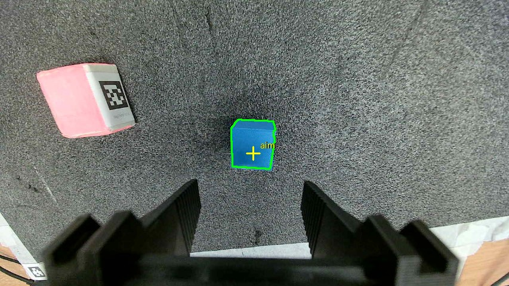 |  |

## What the agent sees

| Top camera (it measures positions) | Depth camera, colour picture | Wrist camera |
|---|---|---|
| 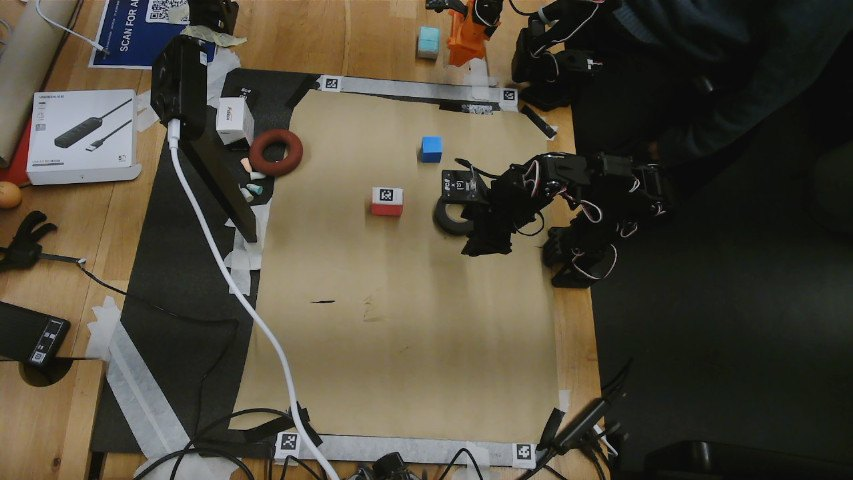 |  |  |

The top camera gives positions on the table in the frame of the robot base:


The depth camera gives heights. The agent gets the table as a map: each cell has the height of the object
on it.

| Raw depth picture | Height map (millimetres) | Which arm can pick which object |
|---|---|---|
|  |  | 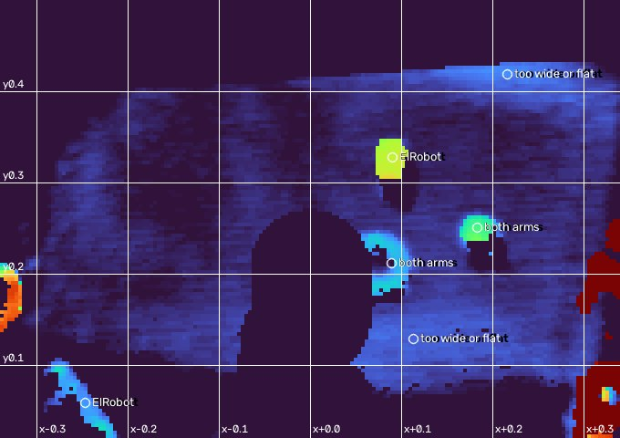 |

| Measurement | Depth camera | Compared with |
|---|---|---|
| Height of the blue cube | 29 mm | 30 mm (its size) |
| Height of the pink block | 27 mm | 28 mm (top camera) |
| Height of the cyan sponge | 19 mm | 33 mm (top camera); the two cameras do not agree here |
| Distance between two mat tags | 2 mm different | 585 mm (ruler) |
| Flatness of the mat | 1.6 to 1.8 mm | |
| Position of three objects | 7 to 11 mm different | top camera |

## Talk to the robot

The person does not need a terminal. The web UI has a chat box and a microphone. Type, or hold the space bar
(or the talk button) and speak, or turn on hands-free and speak. The robot answers in speech and moves the arm.

**Text chat and voice chat both work in English, German and French.** Speak or type in one of the three
languages, and the robot replies in that language.


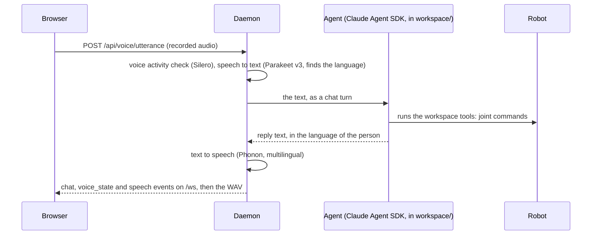

| Part | What it does |
|---|---|
| Browser | records the microphone, plays the reply; shows the state: listening, transcribing, thinking, speaking, acting |
| Languages | English, German and French, in text chat and in voice chat (`ELROBOT_LANGUAGES`, default `en,fr,de`); the reply comes in the language that the person used |
| Speech to text | NVIDIA Parakeet TDT 0.6B v3 through onnxruntime, local; it finds the language itself; Whisper as a fallback |
| Voice activity | Silero VAD: audio that is only noise starts no turn |
| Agent | Claude Agent SDK in the same workspace, with the same tools and skills as a coding agent; a faster fallback model if the main model is not available |
| Text to speech | Phonon (Gradium), local; the 40M multilingual model speaks English, German and French |
| Stop | `POST /api/chat/interrupt` stops the turn and the robot; the STOP button in the UI does the same |
| API | `POST /api/chat`, `POST /api/voice/utterance`, `GET /api/voice/audio/{id}.wav`; details in `docs/API.md` |

What we measured:

| Test | Result |
|---|---|
| Typed request, agent replies | reply after 1.1 s, with a speech clip |
| Request to look at the table on the real cameras | the agent ran `describe_objects`, named the objects, and replied after 3.7 s |
| Speech to text on a recorded clip | the text came back exactly |
| Speech through the browser, end to end | team use during the hackathon; no recorded measurement |

The license of the 40M multilingual Phonon model is CC BY-NC: not for commercial use.

## One demonstration, then the agent repeats it

The task: the ElRobot gives a 30 mm cube to the SO-101 in the air.

There were two stages.

**Stage 1: computed.** The agent computed the two poses from the depth camera and from a calibration
between the arms. Attempts 1 to 11 in the chart are from this stage. Three of them worked. Attempts 10 and
11 used the computed poses from attempt 9, which the tool had kept.

**Stage 2: from one demonstration.** A person showed the full sequence one time. The motors of the two arms
were off, and the person moved the arms by hand:

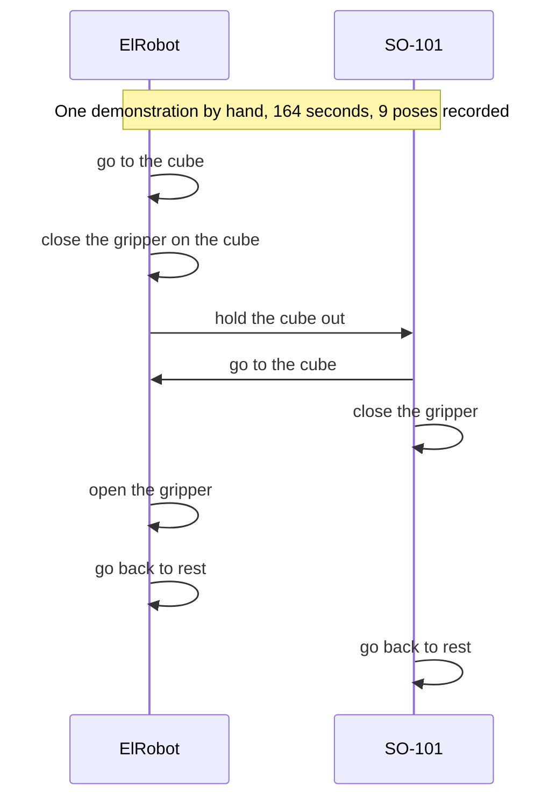

`record_poses` kept each pose where the two arms were still for 1.5 seconds. The agent then played the
sequence back. The two arms came back to the shown poses within 2 mm, but the first replay missed: the cube
was further back in the fingers than in the demonstration. The agent added a step (change 4 in the table),
and 4 of the next 6 attempts worked. These are attempts 12 to 17 in the chart, between 14:09 and 14:36.

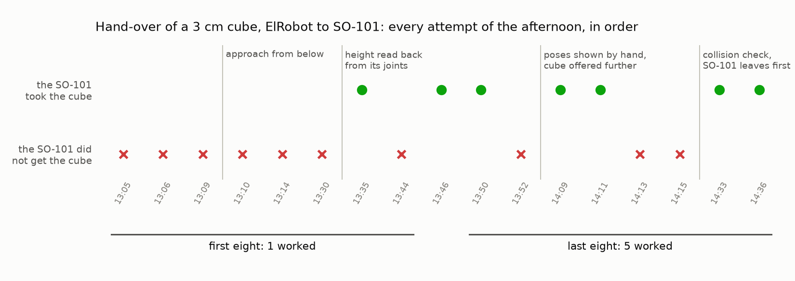

The chart shows each attempt in which the two arms went for the cube. It does not show the calls that
stopped before the arms moved. In attempt 16 the cube changed hands, and then the tool reported an error for
the last move.

The agent ran the attempts and changed the tools. A person put the cube back on the mat when it was out of
reach, and a person adjusted one pose by hand in attempt 8.

The changes that the agent made, in sequence:

| # | The attempt failed because | The agent changed |
|---|---|---|
| 1 | The SO-101 has no level pose near its base. | The SO-101 comes to the cube from below. |
| 2 | The SO-101 stops 8 to 18 mm too low when it moves up. | The tool reads the joints after the move and corrects the height. |
| 3 | The computed poses worked in 3 of 11 attempts. | The tool uses the poses that the person showed. |
| 4 | The cube sits approximately 10 mm further back in the fingers than in the demonstration. | The ElRobot offers the cube 1 cm further, a maximum of 3 times. |
| 5 | The ElRobot stopped 17 mm from the shown pose one time. The SO-101 hit a roll of tape one time. | The tool corrects the ElRobot pose. A collision check stops unsafe paths. The SO-101 leaves first. |

The time from the first attempt to the last attempt was 91 minutes.

| A grip that missed, and a grip that worked | After the hand-over |
|---|---|
| 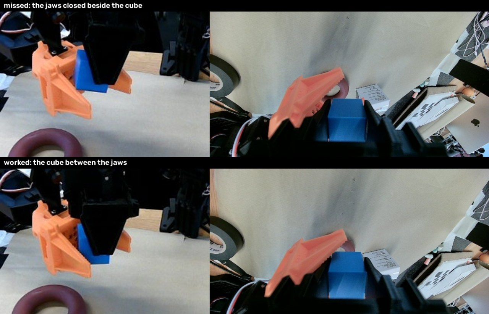 |  |

Why does it not work each time? The jaws open 53 mm and the cube is 30 mm. That leaves 11 mm on each side.
The errors that remain add up to approximately the same amount:

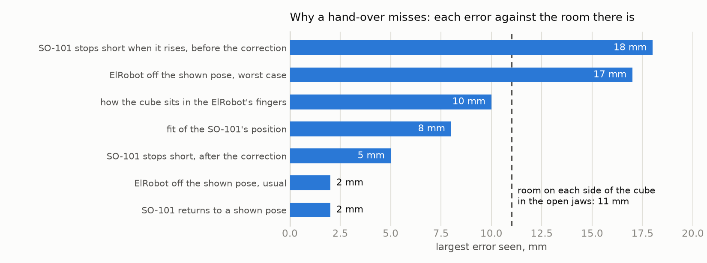

## Ablations

Each change, off and on, on the real arms. The counts are small, so read them as direction, not as proof.

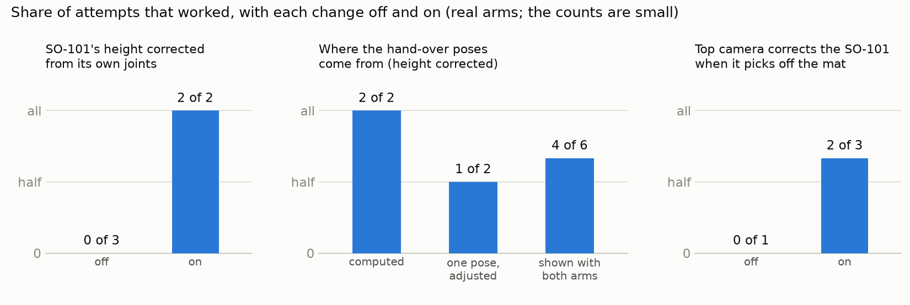

| Change | Off | On |
|---|---|---|
| Height of the SO-101 corrected from its joints (computed poses) | 0 of 3 | 2 of 2 |
| Top camera corrects the SO-101 when it picks from the mat | 0 of 1 | 2 of 3 |
| Obstacle map and the lift-over rule, same carry | refused: the path went through a 47 mm block | the carry went above the block |

Where the hand-over poses come from, with the height correction on:

| Source of the poses | Worked |
|---|---|
| Computed from the depth camera | 2 of 2 |
| One pose that a person adjusted | 1 of 2 |
| All poses shown by hand with the two arms | 4 of 6 |

Attempt 8 is not in these tables: the hand of a person was on the arm during that attempt.

One more observation: the step "the ElRobot offers the cube further" was necessary in the first replay and
in 1 of the 3 later successes for which we have a record.

## Two arms in one space

The two daemons use one NormaCore Station. The workspace has one model of the two arms.

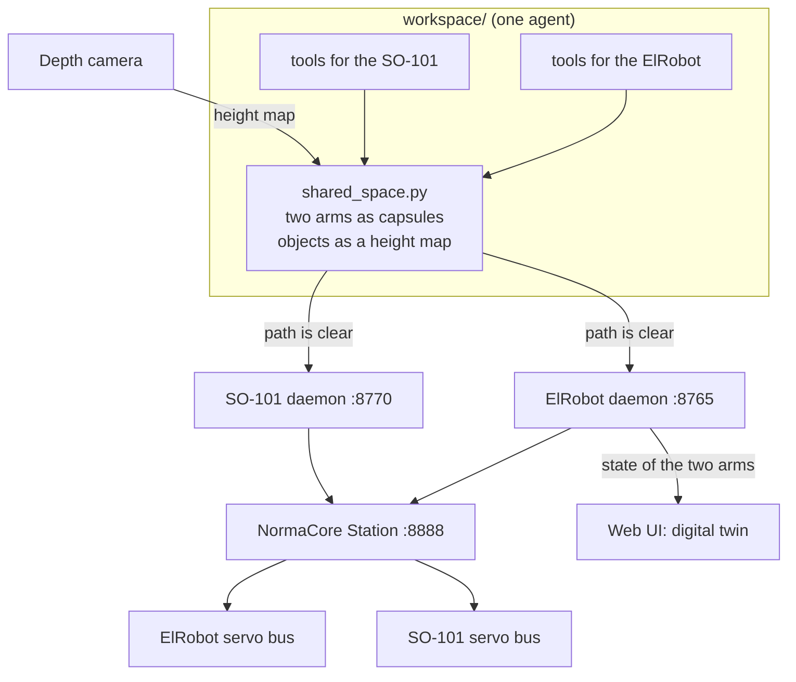

Before a move starts, the tool walks the full joint path in this model:

- If a part comes nearer than 2 cm to the other arm, the move is refused.
- If a part goes into an object on the table, the move is refused.
- If an object is on a straight carry, the arm goes up, across and down.

The model includes the wrist camera of each arm. The depth camera supplies the objects (the two dark areas
are the arms, which the tool removes from the map):

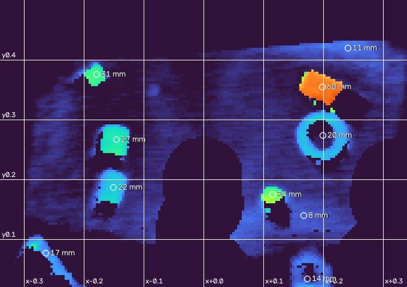

A refusal, in the words of the tool:

```
not moving: on the way this arm's gripper would hit the thing 47 mm tall at x=+0.078 y=+0.250.
Go over it or another way; if it has been moved since, scan again (tools/scan_obstacles.py).
```

The web UI shows a failed hand-over in red, with the cause. The twin shows where the two grippers were:


## The SO-101 with a decision model

One team member controlled the SO-101 with a different approach (branch `autopilot`). There is no coding
agent in the loop.

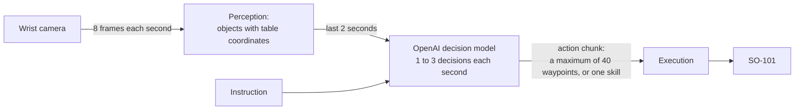

| | Coding agent in the harness | Decision model (`autopilot`) | Source |
|---|---|---|---|
| Output of the model | Python that calls tools | waypoints for the tool point, or the name of a skill | code |
| Rate | seconds for each step | 1 to 3 decisions each second | code |
| Speed of one decision | | approximately 2 times faster | team report |
| Cost | | much lower | team report |
| Camera-to-robot calibration step | necessary | not necessary: the wrist picture shows table coordinates as dots, from the arm model | code |
| Success on simple pick tasks | | similar to the harness | team report |
| Same commands the second time | yes, the same script | the model makes a new plan each time | design |
| Keeps what it learned | yes, as tools and skills | no | design |

"Team report" means: the team saw this during the tests. We did not record these numbers in the repository.

Our conclusion: the decision model is the fast path for simple tasks. The harness is the path for tasks that
must use the same commands each time, and for corrections that must stay.

## What did not work

| What | Why | State |
|---|---|---|
| Dream-1 API, vision to gripper position | The positions were off on both the ElRobot and the SO-101. | stopped |
| Safe mode and collaboration mode | They decreased the reach and the speed too much. | removed after one morning |
| Hand-over of the pink foam block | The fingers of the ElRobot cover the block. The SO-101 has nothing to hold. | not possible with these fingers |
| Stacking by the SO-101 | Its position at the table is 2.5 to 4.5 cm wrong. The calibration was in the air. | open; a calibration at the table is necessary |
| Correction of the SO-101 with the top camera | The camera of the SO-101 hides its gripper from above. | not reliable |
| Chess and drawing on the real arm | We did not try them on the real arm. | simulator only |
| The newest Orbbec software for the depth camera | It does not know the protocol of this camera. | we built the old version from source |

## What we learned

1. **Keep the contract small.** Joint commands only. Each new function was Python in the workspace, and no
   new function needed a change of the robot side.
2. **Return measurements, not "ok".** Each correction that the agent made started from a number in a tool
   result: a width in the jaws, a height that was 16 mm short, a gap of 18 mm.
3. **Measure and use with the same sensor.** A calibration that was made with the depth camera cancels the
   error of the depth camera. A calibration from a ruler does not.
4. **A calibration is valid only where you made it.** The SO-101 was accurate to 8 mm in the air and wrong by
   4.5 cm at the table.
5. **One demonstration is a good start, not the solution.** The arms came back to the shown poses within
   2 mm, and the first replay missed. One more correction gave 4 of 6.
6. **Soft servos do not stop where you command them.** Read the joints after each move. Correct the pose.
7. **A check that refuses is better than no check.** The collision check refused two moves that were
   safe. We adjusted the rule. Before the check, the SO-101 hit a roll of tape one time.
8. **An obstacle map becomes old fast.** The arms move the objects that are on the map. Our map is valid for
   two minutes.
9. **Small counts are not proof.** Our best result is 5 of 8. We give each count so that you can make your
   own decision.
10. **A fast model and a careful agent are for different tasks.** We did not find one approach that was best
    for all tasks.

## Technology

| Area | What we used |
|---|---|
| Robot arms | NormaCore ElRobot (7 joints), SO-ARM101 (5 joints), the NormaCore parallel gripper on each |
| Servos and bus | Feetech ST3215 at 7.5 V and 12 V, NormaCore Station |
| Agents | Claude Code, Codex, pi; Claude Agent SDK for the chat and voice agent |
| Models that we tested | Claude, an OpenAI decision model, the Dream-1 API (vision to gripper position) |
| Kinematics | Pinocchio and Pink (inverse kinematics), DAQP (solver), URDF models of the two arms |
| Collision model | capsules for each arm part, a height map for objects (our code) |
| Vision | OpenCV, AprilTag markers (25h9), SAM 3 for segmentation, colour segmentation, an object tracker |
| Cameras | UGREEN webcam (top), KD USB camera (wrist), Orbbec DaBai DCW2 (depth), Innomaker U20CAM (SO-101) |
| Depth | Orbbec SDK version 1, built from source |
| Daemon | Python 3.12, FastAPI, uvicorn, WebSocket, MCP server |
| Web UI | React, three.js, urdf-loader (digital twin of the two arms) |
| Speech | Parakeet v3 (speech to text), Silero VAD, Phonon (text to speech), Whisper as a fallback; English, German and French |
| Environment and tests | pixi, uv, pytest, a simulator of the arm and the table |

## Run it

Simulator, no hardware:

```bash
pixi run sim
cd workspace && claude          # or codex, or pi: the agent reads AGENTS.md
```

Real ElRobot. Build the Station first (see `CLAUDE.md`):

```bash
scripts/cameras_ready.sh && pixi run up     # Station, daemon, web UI on http://127.0.0.1:8765
cd workspace && claude
```

With the SO-101 as the second arm, in a second terminal:

```bash
scripts/second_arm_up.sh                    # the SO-101 daemon on port 8770
```

One tool by hand:

```bash
cd workspace
uv run python tools/find_objects.py '{}'
uv run python tools/pick_at.py '{"x": 0.10, "y": 0.20, "yaw_deg": 0}'
```

Tests:

```bash
(cd workspace && uv run --with pytest pytest -q tests)     # workspace code, less than 1 second
uv run --with pytest pytest tests -q                       # simulator tests, approximately 10 minutes
```

## Repository

| Folder | Contents |
|---|---|
| `workspace/` | where the agent works: tools, skills, robot models, live perception, call history |
| `src/elrobot/` | the robot side: daemon, servo link, kinematics, simulator |
| `station/` | configuration of the NormaCore Station |
| `scripts/` | start, camera setup and calibration scripts |
| `web/` | the web UI |
| `docs/` | documentation |

| Question | File |
|---|---|
| What can it do, and how well is each part proven? | `docs/FEATURES.md` |
| What did we see and measure? | `docs/RESULTS.md` |
| How do the two arms work together? | `docs/SECOND_ARM.md` |
| Why is it built this way? | `docs/DECISIONS.md` |
| Tools, joint commands, files, frames, units | `docs/INTERFACE.md` |
| The HTTP and WebSocket API of the daemon | `docs/API.md` |
| How does an agent operate the arm? | `workspace/AGENTS.md`, `workspace/skills/` |
| Current state and next steps | `docs/HANDOFF.md`, `docs/PLAN.md` |
| History | `docs/CHANGELOG.md` |
