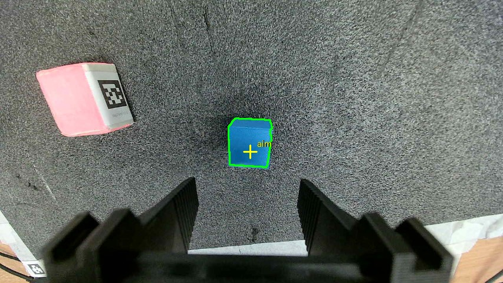
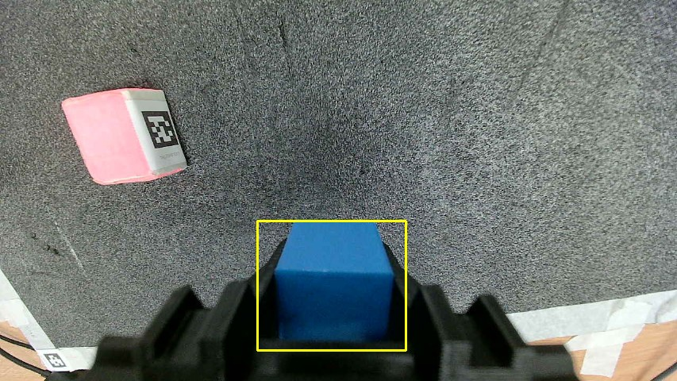
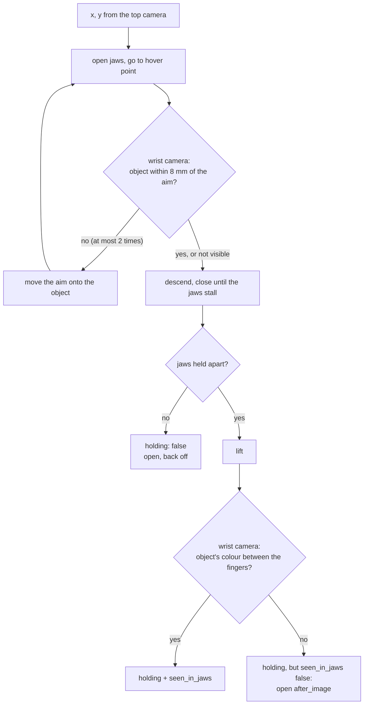
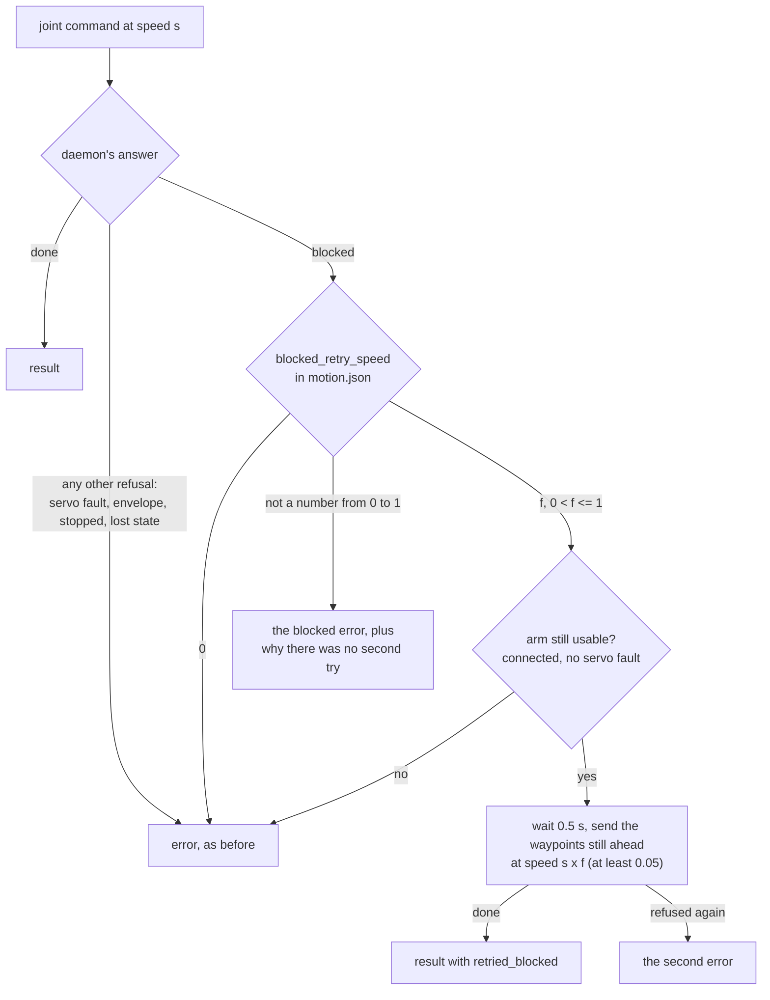
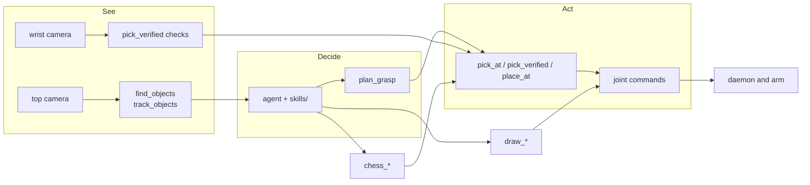

# Features

This document tells you what the harness can do today. It also tells you how far each part is proven, and where each part is.
"Real" means that the feature ran on the physical arm. The word "sim" means that the feature ran only in the simulator (`pixi run sim`, or the tests).
Last updated 2026-11-22.

## Status at a glance

| Feature | Tools | Proven | Notes |
|---|---|---|---|
| Wake, home, rest, stop | `home`, `rest`, `stop` | real | `rest` switches the motors off. `home` from rest at speed 0.5 or less |
| Move the tool point | `move_tcp`, `adjust_tcp`, `joint_command` | real | Straight-down poses are possible only within about 27 cm of the base |
| See the table | `capture_camera`, `find_objects`, `pixel_to_table`, `look_at_table` | real | Since 2026-11-22, the top camera is the UGREEN above the mat |
| A blocked move is tried again, slower | every tool, through `util/arm.py` `Arm.joints` | tests with a faked daemon; not yet seen on the real arm | The second try occurs one time. It starts from where the arm stopped. Its speed is `blocked_retry_speed` (0.5) of the speed of the move. The setting is in `workspace/robot_config/motion.json`. Refer to "When a move is blocked" |
| Pick and place by position | `pick_at`, `place_at` | real | These tools check nothing by camera |
| Objects by name, world model | `describe_objects`, `name_objects`, `world_model`, `grasp_object`, `put_object` | sim for pick and place by name; `describe_objects` and naming run on the real table (camera only) | The agent names objects from a picture sheet. An object keeps its name after a move. The tools recognise a ring by its hole, and the arm grips the ring by the rim. The rim grasp of `grasp_object` is not yet tried on the real arm. Team report: the arm picked a ring by its rim with `pick_at` (refer to the pick-and-place skill) |
| Writing a skill after a new task | `create_skill` | sim | The tool appends the actual tool calls. It includes the failures |
| Hand-guiding and replay (one-shot teaching) | `hand_guide`, `replay_demo`, `POST /api/guide` | sim; on the real arm it held still for 8 s untouched, nobody has led it yet | The arm follows the push of a hand and stays where the hand leaves it. The harness saves stretches and jaw steps in `state/demos/` and replays them as joint angles. The replay repeats the motion, not the intention |
| Heights from the depth camera | `depth_scan`, `calibrate_depth` | real (camera only) | The camera is an Orbbec DaBai DCW2 across the table. A 30 mm cube read 29 mm. Positions are accurate to about 1 cm. No grasp uses it yet. This feature needs `scripts/orbbec_setup.sh` once per machine |
| Second arm (SO-101) | `second_arm`, `calibrate_second_arm`, `arms_clearance`, `scripts/second_arm_up.sh` | real | It runs on the daemon of the `autopilot` branch, beside this one. In the air, the fit is accurate to 4 to 8 mm. At the table, when it points down, it is 2.5 to 4.5 cm off. Refer to `docs/SECOND_ARM.md` |
| Hand-over, ElRobot to SO-101 | `hand_over`, `teach_hand_over`, `record_poses`, `replay_poses` | real: 7 of 10 unattended since the height correction | A 3 cm cube held by its top. The tool computes the hand-over from the depth camera, or from poses that a person showed with both arms limp. To try again, it offers the cube further. The hand-over of the pink block is not possible |
| One space for both arms | `tools/util/shared_space.py`, `arms_clearance` | real | Capsules for both arms, wrist cameras included. The harness refuses a move within 2 cm of the other arm. It was seen to refuse a move. It was also seen to let a full cycle through |
| Things on the table as obstacles, carrying over them | `scan_obstacles`; `pick_at`, `place_at` | real | The obstacles come from the height map of the depth camera. The harness uses a height map for two minutes. The harness refused a carry through a 47 mm block. Then the carry went over the block |
| Stacking by the second arm | `second_arm_stack` | real: not achieved | The second arm picked the cube 2 times in 4 while the top camera corrected it. It set the cube beside the base both times |
| Both arms, obstacles and planned paths in the 3D view | web UI | real for the arms and the labels; columns and the SO-101's path not yet seen | The daemon relays the SO-101's state and model. The scan and the tools send the rest |
| Pick with wrist-camera checks | `pick_verified` | real (one cube, three runs) | The tool corrects the aim from the hover point. It confirms that the object is in the jaws |
| Live tracking, pick and place by name | `track_objects`, `pick_object`, `place_object` | real with the old top camera; not re-run since the camera change | A name is a colour plus a number (`blue-1`) |
| Piles the arm did not build | `track_objects` (`on_source: "inferred"`) | sim | If an object disappears while a second object changes colour, outline or height, the tracker concludes that the first lies on the second. Two objects that touch side by side look the same. The plan and the limits are in `docs/OVERLAPPING_OBJECTS.md` |
| Grasp planning among neighbours | `plan_grasp` | sim | The neighbours come from `find_objects`. The arm's own parts can appear there as grey objects |
| Chess against a person | `chess_setup`, `chess_see`, `chess_move`, `chess_record` | sim | It needs squares of 30 mm or less. Refer to "Known limits" |
| Drawing with a pen | `draw_plan`, `draw_pen`, `draw_run` | sim | A person seats the pen with its tip on the paper |
| The plan on screen: what is running now, what comes next | `show_steps`, the web UI's Steps panel (switch in the top bar) | sim and the UI's demo mode | It shows what the agent announces. If an agent does not call it, only the "now" line stays |
| Skills | `activate_skill`, `deactivate_skill` | real | `skills/*/SKILL.md`: pick-and-place, recover, direct-joint-control, play-chess, draw |
| Camera panel: switch feeds, live vision layers | web UI, `GET /api/camera/{name}/vision` | sim (UI checked against the simulator) | There are tabs for every camera. There are toggles for Objects, Tags, Frame, Arm, Tools. `?camera=top&layers=objects,frame,arm` opens the panel that way |
| Chat and voice in the web UI, driving the workspace | chat box, microphone; `src/elrobot/voice/` | The agent answered a look-only request on the real cameras (ran `describe_objects`, named what it saw) in 3.7 s. Speech in and out tested on Linux outside the daemon. Not yet run through the browser end to end | Start it with `pixi run up`. Use `ELROBOT_CHAT_AGENT=mcp` for the older tool set |
| Web UI, MCP server, voice agent | `web/`, `src/elrobot/mcp_server.py`, `src/elrobot/voice/` | built by teammates; not exercised in the 2026-11-22 sessions | Refer to `CLAUDE.md` and `docs/API.md` |

## A verified pick, in pictures

`pick_verified` looks through the wrist camera two times. Left: the view is from the hover point. An outline
marks the object, and the cross is where the jaws aim. If the two differ, the tool moves the aim onto the
object. Right: after the lift, the object's colour should fill the yellow box between the fingers. The
pictures are from a real run on 2026-11-22.

| Before the grasp | After the lift |
|---|---|
|  |  |



## When a move is blocked

The daemon stops a move as "blocked" when a joint is behind its setpoint by more than 12.6 degrees for half a
second. On this arm, that is most often a move that was too fast or too heavy, with nothing in the way. The
same move is successful at a lower speed. Thus `Arm.joints` sends the move once more automatically. Every tool
ends in `Arm.joints`.



`blocked_retry_speed` is the one setting. It is in `workspace/robot_config/motion.json`. The value 0.5 (the
default) gives a second try that is half as fast. The value 1 gives the same speed again. The value 0 gives no
second try. The harness reads the setting each time a move is blocked, so an edit needs no restart. Both tries
are in the `joint_commands.jsonl` of the call. The harness does not try a gripper-only command again. A tool
that intends to stop on contact passes `retry_blocked=False`. `draw_run` does this for its strokes, where
blocked means that the pen presses too hard.

## How the pieces fit



## Where things are

| Path | What |
|---|---|
| `workspace/` | The agent's working directory: tools, skills, robot model, live perception, call history. Start an agent here. `workspace/AGENTS.md` is its manual. |
| `workspace/tools/NAME.py` | Each file contains one tool: `def NAME(ctx, ...)`. `workspace/tools/util/` is shared code (IK, planning, camera models, tracker, chess, strokes). |
| `workspace/robot_config/` | URDF, camera calibrations (`camera_top.json`, `camera_wrist.json`), resting pose, `motion.json` (how much slower the second try of a blocked move is). |
| `workspace/state/` | The data that tasks remember between calls (`chess.json`, `drawing.json`). Not committed. |
| `src/elrobot/` | The robot side: daemon, servo link, kinematics, simulator. It owns the arm. It takes joint commands. |
| `station/` | NormaCore Station config. The build of the Station binary (`bin/station`) is separate. |
| `scripts/` | Bring-up helpers: `probe.py`, `cameras_ready.sh`, `calibrate.py`, `calibrate_camera.py`. |
| `tests/` | Simulator tests. Run `uv run --with pytest pytest -q`. The run takes about 5 minutes. |
| `workspace/tests/` | Tests of the workspace code with a faked daemon, with no robot and no simulator. Run `cd workspace && uv run --with pytest pytest -q tests`. The run takes under a second. |

## Starting it

```bash
scripts/cameras_ready.sh        # only if the Station is not running: hands cameras to the kernel driver, sets exposure
pixi run up                     # Station + daemon for the real arm   (pixi run sim: simulated arm)
cd workspace && claude          # or any agent; it reads AGENTS.md
```

## Known limits

- **Accuracy decreases with reach.** The accuracy is about 1 cm within 25 cm of the base, and 2 cm or more
  beyond 30 cm. The wrist-camera calibration measured these values (refer to `CLAUDE.md`). The top camera also
  reads an object 1 to 1.5 cm too far along the reach. `pick_verified` removes that error.
- **Reach on the table** is roughly 9 to 36 cm from the base. The daemon refused one `place_at` 13 cm in front
  of the base as blocked on joint 2. This was before the harness tried blocked moves again slower. It was not
  repeated since then.
- **The slower second try has not run on the real arm.** By hand, it was seen that a blocked move is
  successful at a lower speed. Only `workspace/tests/test_blocked_retry.py` covers the automatic second try.
  Also, the second try cannot tell the difference between load and an obstacle. Against a real obstacle, the
  arm pushes a second time, slower, before the error.
- **The top camera's position** (79 cm above the mat, from the tag homography) is probably incorrect. The mask
  that hides the arm from `find_objects` no longer covers the arm, so arm parts appear as grey objects.
- **Chess** identifies squares as empty, light piece or dark piece. The piece types come from the tracked
  game, not from the image. It has never run on a real board.
- **Drawing** uses the arm's own give for pen pressure (`press`). It has never run on real paper.
- **Objects the colour of the mat, or black.** `find_objects` and the look of `pick_verified` miss these
  objects.
- **Tests under load:** while three cameras streamed, `tests/test_workspace.py::test_pick_goes_to_where_the_object_is_by_then`
  failed one time in a full run. It passed alone.
