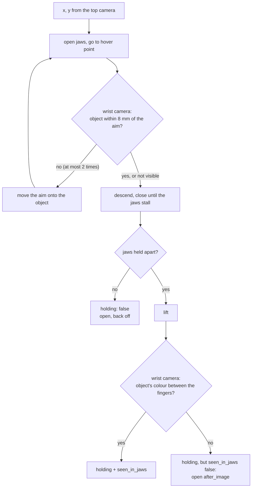
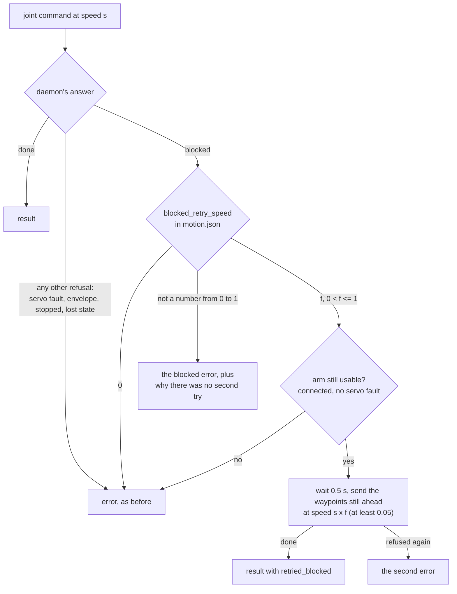
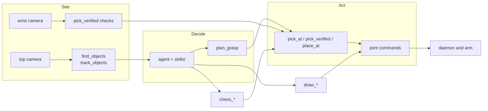

# Features

What the harness can do today, how far each part has been proven, and where it lives.
"Real" means run on the physical arm; "sim" means only in the simulator (`pixi run sim`, or the tests).
Last updated 2026-11-22.

## Status at a glance

| Feature | Tools | Proven | Notes |
|---|---|---|---|
| Wake, home, rest, stop | `home`, `rest`, `stop` | real | `rest` switches the motors off; `home` from rest at speed 0.5 or less |
| Move the tool point | `move_tcp`, `adjust_tcp`, `joint_command` | real | Straight-down poses only within about 27 cm of the base |
| See the table | `capture_camera`, `find_objects`, `pixel_to_table`, `look_at_table` | real | Top camera is the UGREEN above the mat since 2026-11-22 |
| A blocked move is tried again, slower | every tool, through `util/arm.py` `Arm.joints` | tests with a faked daemon; not yet seen on the real arm | Once, from where the arm stopped, at `blocked_retry_speed` (0.5) of its speed: `workspace/robot_config/motion.json`. See "When a move is blocked" |
| Pick and place by position | `pick_at`, `place_at` | real | Checks nothing by camera |
| Objects by name, world model | `describe_objects`, `name_objects`, `world_model`, `grasp_object`, `put_object` | sim for pick and place by name; `describe_objects` and naming run on the real table (camera only) | The agent names objects from a picture sheet; names survive moves. A ring is recognised by its hole and gripped by the rim (rim grasp not yet tried on the real arm) |
| Writing a skill after a new task | `create_skill` | sim | Appends the tool calls actually made, failures included |
| Safe mode: straight down, straight lines, refuse what is too far | `robot_config/motion.json` `safe_mode`, `tools/util/safe.py` | sim | On by default for the real arm, not yet run on it. Shrinks the working area to about 32 x 12 cm in front of the base |
| Pick with wrist-camera checks | `pick_verified` | real (one cube, three runs) | Corrects the aim from the hover point, confirms the object is in the jaws |
| Live tracking, pick and place by name | `track_objects`, `pick_object`, `place_object` | real with the old top camera; not re-run since the camera change | Names are colour plus a number (`blue-1`) |
| Piles the arm did not build | `track_objects` (`on_source: "inferred"`) | sim | An object that vanishes while another changes colour, outline or height is taken to lie on it. Side by side and touching looks the same; plan and limits in `docs/OVERLAPPING_OBJECTS.md` |
| Grasp planning among neighbours | `plan_grasp` | sim | Neighbours come from `find_objects`; the arm's own parts can show up there as grey objects |
| Chess against a person | `chess_setup`, `chess_see`, `chess_move`, `chess_record` | sim | Needs squares of 30 mm or less; see "Known limits" |
| Drawing with a pen | `draw_plan`, `draw_pen`, `draw_run` | sim | A person seats the pen with its tip on the paper |
| The plan on screen: what is running now, what comes next | `show_steps`, the web UI's Steps panel (switch in the top bar) | sim and the UI's demo mode | Shows what the agent announces; an agent that does not call it leaves only the "now" line |
| Skills | `activate_skill`, `deactivate_skill` | real | `skills/*/SKILL.md`: pick-and-place, recover, direct-joint-control, play-chess, draw |
| Camera panel: switch feeds, live vision layers | web UI, `GET /api/camera/{name}/vision` | sim (UI checked against the simulator) | Tabs for every camera; toggles for Objects, Tags, Frame, Arm, Tools. `?camera=top&layers=objects,frame,arm` opens it that way |
| Chat and voice in the web UI, driving the workspace | chat box, microphone; `src/elrobot/voice/` | The agent answered a look-only request on the real cameras (ran `describe_objects`, named what it saw) in 3.7 s. Speech in and out tested on Linux outside the daemon. Not yet run through the browser end to end | Start with `pixi run up`. `ELROBOT_CHAT_AGENT=mcp` for the older tool set |
| Web UI, MCP server, voice agent | `web/`, `src/elrobot/mcp_server.py`, `src/elrobot/voice/` | built by teammates; not exercised in the 2026-11-22 sessions | See `CLAUDE.md` and `docs/API.md` |

## A verified pick, in pictures

`pick_verified` looks through the wrist camera twice. Left: from the hover point, the object is outlined and
the cross is where the jaws aim; the aim is moved onto the object if they differ. Right: after lifting, the
object's colour should fill the yellow box between the fingers. Real run, 2026-11-22.

| Before the grasp | After the lift |
|---|---|
|  |  |



## When a move is blocked

The daemon stops a move as "blocked" when a joint trails its setpoint by more than 12.6 degrees for half a
second. On this arm that is most often a move that was too fast or too heavy with nothing in the way, and the
same move goes through slower. So `Arm.joints`, which every tool ends in, sends it once more by itself.



`blocked_retry_speed` is the one setting, in `workspace/robot_config/motion.json`: 0.5 (the default) is half as
fast, 1 the same speed again, 0 no second try. It is read each time a move is blocked, so an edit needs no
restart. Both tries are in the call's `joint_commands.jsonl`. A gripper-only command is not tried again, and a
tool that means to stop on contact passes `retry_blocked=False`; `draw_run` does for its strokes, where blocked
means the pen presses too hard.

## How the pieces fit



## Where things are

| Path | What |
|---|---|
| `workspace/` | The agent's working directory: tools, skills, robot model, live perception, call history. Start an agent here. `workspace/AGENTS.md` is its manual. |
| `workspace/tools/NAME.py` | One tool per file: `def NAME(ctx, ...)`. `workspace/tools/util/` is shared code (IK, planning, camera models, tracker, chess, strokes). |
| `workspace/robot_config/` | URDF, camera calibrations (`camera_top.json`, `camera_wrist.json`), resting pose, `motion.json` (how much slower a blocked move is tried again). |
| `workspace/state/` | What tasks remember between calls (`chess.json`, `drawing.json`). Not committed. |
| `src/elrobot/` | The robot side: daemon, servo link, kinematics, simulator. Owns the arm; takes joint commands. |
| `station/` | NormaCore Station config. The Station binary (`bin/station`) is built separately. |
| `scripts/` | Bring-up helpers: `probe.py`, `cameras_ready.sh`, `calibrate.py`, `calibrate_camera.py`. |
| `tests/` | Simulator tests. `uv run --with pytest pytest -q`, about 5 minutes. |
| `workspace/tests/` | Tests of workspace code with the daemon faked, no robot and no simulator. `cd workspace && uv run --with pytest pytest -q tests`, under a second. |

## Starting it

```bash
scripts/cameras_ready.sh        # only if the Station is not running: hands cameras to the kernel driver, sets exposure
pixi run up                     # Station + daemon for the real arm   (pixi run sim: simulated arm)
cd workspace && claude          # or any agent; it reads AGENTS.md
```

## Known limits

- **Accuracy falls off with reach.** About 1 cm within 25 cm of the base, 2 cm or more beyond 30 cm
  (measured by the wrist-camera calibration, see `CLAUDE.md`). The top camera also reads an object
  1 to 1.5 cm too far along the reach; `pick_verified` takes that out.
- **Reach on the table** is roughly 9 to 36 cm from the base. One `place_at` 13 cm in front of the base was
  refused as blocked on joint 2 (before blocked moves were tried again slower; not repeated since).
- **The slower second try has not run on the real arm.** That a blocked move goes through slower was seen by
  hand; the automatic retry is covered by `workspace/tests/test_blocked_retry.py` only. It also cannot tell
  load from an obstacle: against a real obstacle the arm pushes a second time, slower, before the error.
- **The top camera's position** (79 cm above the mat, from the tag homography) is probably off: the mask that
  hides the arm from `find_objects` no longer covers it, so arm parts appear as grey objects.
- **Chess** identifies squares as empty, light piece or dark piece; piece types come from the tracked game,
  not from the image. Never run on a real board.
- **Drawing** relies on the arm's own give for pen pressure (`press`); never run on real paper.
- **Objects the colour of the mat, or black**, are missed by `find_objects` and by `pick_verified`'s look.
- **Tests under load:** with three cameras streaming, `tests/test_workspace.py::test_pick_goes_to_where_the_object_is_by_then`
  failed once in a full run and passed alone.
