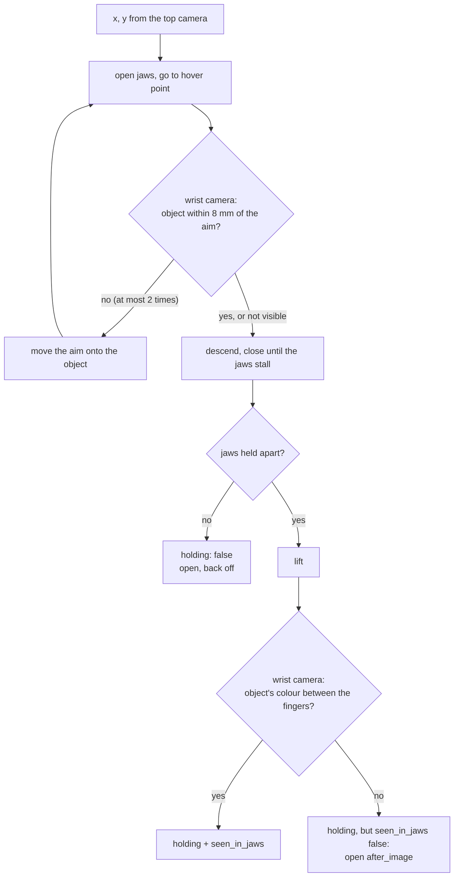
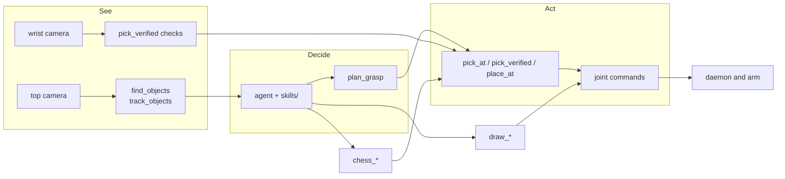

# Features

What the harness can do today, how far each part has been proven, and where it lives.
"Real" means run on the physical arm; "sim" means only in the simulator (`pixi run sim`, or the tests).
Last updated 2026-11-22.

## Status at a glance

| Feature | Tools | Proven | Notes |
|---|---|---|---|
| Wake, home, rest, stop | `home`, `rest`, `stop` | real | `rest` switches the motors off; `home` from rest at speed 0.5 or less |
| Move the tool point | `move_tcp`, `adjust_tcp`, `joint_command` | real | Straight-down poses only within about 27 cm of the base |
| See the table | `capture_camera`, `find_objects`, `pixel_to_table`, `look_at_table` | real | Top camera is the UGREEN above the mat since 2026-11-22 |
| Pick and place by position | `pick_at`, `place_at` | real | Checks nothing by camera |
| Pick with wrist-camera checks | `pick_verified` | real (one cube, three runs) | Corrects the aim from the hover point, confirms the object is in the jaws |
| Live tracking, pick and place by name | `track_objects`, `pick_object`, `place_object` | real with the old top camera; not re-run since the camera change | Names are colour plus a number (`blue-1`) |
| Grasp planning among neighbours | `plan_grasp` | sim | Neighbours come from `find_objects`; the arm's own parts can show up there as grey objects |
| Chess against a person | `chess_setup`, `chess_see`, `chess_move`, `chess_record` | sim | Needs squares of 30 mm or less; see "Known limits" |
| Drawing with a pen | `draw_plan`, `draw_pen`, `draw_run` | sim | A person seats the pen with its tip on the paper |
| Skills | `activate_skill`, `deactivate_skill` | real | `skills/*/SKILL.md`: pick-and-place, recover, direct-joint-control, play-chess, draw |
| Camera panel: switch feeds, live vision layers | web UI, `GET /api/camera/{name}/vision` | sim (UI checked against the simulator) | Tabs for every camera; toggles for Objects, Tags, Frame, Arm, Tools. `?camera=top&layers=objects,frame,arm` opens it that way |
| Web UI, MCP server, voice agent | `web/`, `src/elrobot/mcp_server.py`, `src/elrobot/voice/` | built by teammates; not exercised in the 2026-11-22 sessions | See `CLAUDE.md` and `docs/API.md` |

## A verified pick, in pictures

`pick_verified` looks through the wrist camera twice. Left: from the hover point, the object is outlined and
the cross is where the jaws aim; the aim is moved onto the object if they differ. Right: after lifting, the
object's colour should fill the yellow box between the fingers. Real run, 2026-11-22.

| Before the grasp | After the lift |
|---|---|
|  |  |



## How the pieces fit



## Where things are

| Path | What |
|---|---|
| `workspace/` | The agent's working directory: tools, skills, robot model, live perception, call history. Start an agent here. `workspace/AGENTS.md` is its manual. |
| `workspace/tools/NAME.py` | One tool per file: `def NAME(ctx, ...)`. `workspace/tools/util/` is shared code (IK, planning, camera models, tracker, chess, strokes). |
| `workspace/robot_config/` | URDF, camera calibrations (`camera_top.json`, `camera_wrist.json`), resting pose. |
| `workspace/state/` | What tasks remember between calls (`chess.json`, `drawing.json`). Not committed. |
| `src/elrobot/` | The robot side: daemon, servo link, kinematics, simulator. Owns the arm; takes joint commands. |
| `station/` | NormaCore Station config. The Station binary (`bin/station`) is built separately. |
| `scripts/` | Bring-up helpers: `probe.py`, `cameras_ready.sh`, `calibrate.py`, `calibrate_camera.py`. |
| `tests/` | Simulator tests. `uv run --with pytest pytest -q`, about 5 minutes. |

## Starting it

```bash
scripts/cameras_ready.sh        # only if the Station is not running: hands cameras to the kernel driver, sets exposure
pixi run up                     # Station + daemon for the real arm   (pixi run sim: simulated arm)
cd workspace && claude          # or any agent; it reads AGENTS.md
```

## Known limits

- **Accuracy falls off with reach.** About 1 cm within 25 cm of the base, 2 cm or more beyond 30 cm
  (measured by the wrist-camera calibration, see `CLAUDE.md`). The top camera also reads an object
  1 to 1.5 cm too far along the reach; `pick_verified` takes that out.
- **Reach on the table** is roughly 9 to 36 cm from the base. One `place_at` 13 cm in front of the base was
  refused as blocked on joint 2.
- **The top camera's position** (79 cm above the mat, from the tag homography) is probably off: the mask that
  hides the arm from `find_objects` no longer covers it, so arm parts appear as grey objects.
- **Chess** identifies squares as empty, light piece or dark piece; piece types come from the tracked game,
  not from the image. Never run on a real board.
- **Drawing** relies on the arm's own give for pen pressure (`press`); never run on real paper.
- **Objects the colour of the mat, or black**, are missed by `find_objects` and by `pick_verified`'s look.
- **Tests under load:** with three cameras streaming, `tests/test_workspace.py::test_pick_goes_to_where_the_object_is_by_then`
  failed once in a full run and passed alone.
