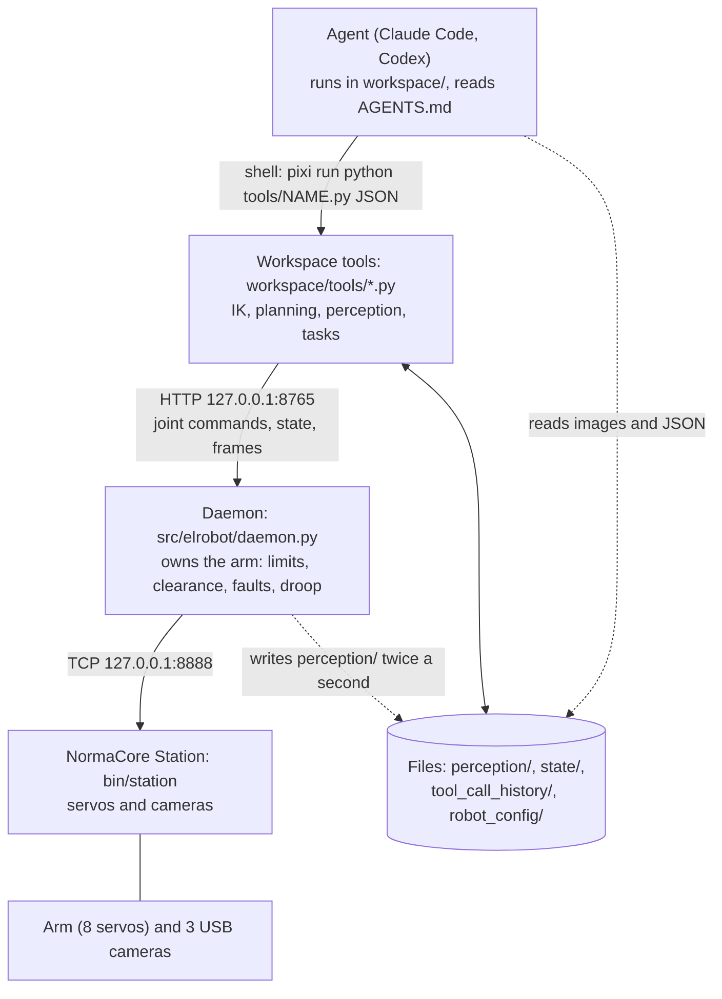
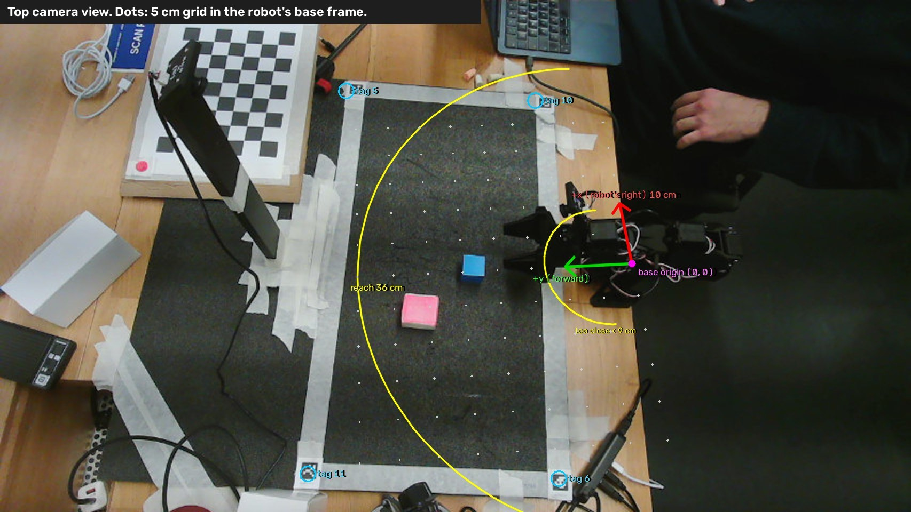
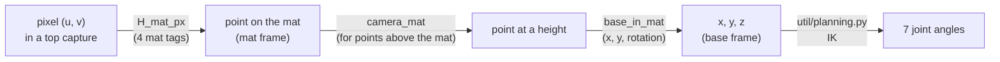
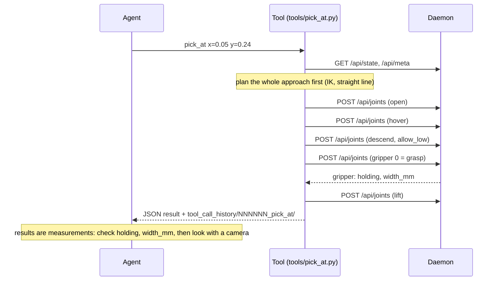

# Interfaces

This document gives the contracts between the parts. It tells you what an agent can call, what a tool is,
what crosses to the robot, and what the files on the disk mean. For the full HTTP and WebSocket contract of
the daemon, refer to `docs/API.md`. For the working rules of the agent, refer to `workspace/AGENTS.md`.
Last updated 2026-11-22.

## Layers



Only joint commands, state reads and camera frames cross from the tools to the daemon.

## Units and frames

- The units are metres and radians. Angles in tool arguments are in degrees, and the argument names show this (`yaw_deg`, `pitch_deg`). The gripper opening is 0 (closed) to 1 (open, 53 mm).
- **Base frame:** The origin is on the table below the base. The x axis points to the right of the robot, the y axis points forward, and the z axis points up. `table_z` (0.010) is the surface of the mat.
- **Tool point (TCP):** The tool point is between the finger pads, 12 mm back from the fingertips. The tool z axis is the approach direction. The tool x axis is the axis along which the jaws close.
- **Mat frame:** The origin is at tag 6. The x axis points towards tag 10. The y axis points towards tag 11. The frame is on the mat surface. Only calibration uses the mat frame.
- `yaw_deg` 0 closes the jaws left-right. `pitch_deg` 90 points straight down.

This image shows the base frame as the top camera sees it (drawn from the saved calibration onto a live frame, 2026-11-22):



This diagram shows how a pixel becomes a position that the arm can go to:



`tools/calibrate_top.py` fits `H_mat_px` and `camera_mat` again whenever the camera moves. It does not fit
`base_in_mat` again. If the robot or the mat moves, measure `base_in_mat` again (refer to `docs/DECISIONS.md`).

## A workspace tool

A workspace tool is a file `workspace/tools/NAME.py`. The file defines `def NAME(ctx, ...) -> dict` and ends
with `run_cli(NAME)`. The module docstring of the file is the description of the tool (`--schema` prints it).
If you add a file, you add a tool.

```bash
pixi run python tools/NAME.py '{"x": 0.1}'     # arguments: one JSON object
pixi run python tools/NAME.py --schema
```

`ctx` (`tools/util/cli.py`):

| Member | What |
|---|---|
| `ctx.arm` | `util/arm.py` `Arm`: `state()`, `meta()`, `q()`, `limits()`, `frame(camera)`, `joints(path, gripper=, speed=, check=, allow_low=, label=, retry_blocked=)`, `torque(bool)`, `stop()` |
| `ctx.plan` | `util/planning.py` `Planner`: `fk`, `solve`, `reach`, `line`, `approach_for`, `blocked`, `table_z` |
| `ctx.frame(camera)` | the newest BGR frame |
| `ctx.save_image(name, img, caption)`, `ctx.save_json(name, obj)` | into the history folder of this call |
| `ctx.call(other_tool, **args)` | runs another tool inside this call |
| `ctx.root`, `ctx.history` | the workspace root; the folder of this call |

The result is JSON on stdout. The exit status is 1 when the result contains `error`. In that case,
`error_kind` is `robot` (something to act on) or `tool_bug` (a crash, with `traceback`). Each result also
contains `history`, `joint_command_count` and `duration_s`. It also contains `images` / `nested_calls` when
there are any. There is no generic success flag. Read the fields of the tool itself. Raise
`util.arm.RobotError` for anything that the caller must act on.



Each call leaves a folder `tool_call_history/NNNNNN_NAME/`. The folder contains `input.json`, `result.json`,
`joint_commands.jsonl` and the images of the call. The folder name of a capture is its `image_id`.

## The joint command (tool to daemon)

`POST /api/joints`

```json
{"path": [[7 angles], ...], "gripper": 0.0, "speed": 0.8, "check": true, "allow_low": false,
 "label": "descending", "source": "agent", "call_id": "..."}
```

- `path`: one or more waypoints. The arm travels them in straight joint-space segments under one speed profile. `path` is optional if you give `gripper`.
- `gripper`: the daemon applies it after the arm arrives. 0 is a grasp: the jaws close until they stall.
- `check: false` skips the clearance envelope. `allow_low: true` lets the fingertips reach the table surface.
- The command returns `{"ok": true, "joints": [...], "gripper": {"open", "width_mm", "holding"}, "tcp": {"pos", "quat", "approach"}}`. Or it returns `{"ok": false, "error": "...", "kind": "invalid" | "busy" | "robot" | "blocked" | "stopped"}` with the reason: outside limits, outside the envelope, blocked joint, servo fault.
- The call returns when the motion is complete. `POST /api/stop` stops a motion. If you kill the caller, the motion does not stop.

The daemon tries nothing twice. `Arm.joints` tries twice, for one error. When a move gets the answer
`blocked: ...`, `Arm.joints` sends the move one more time as a second `POST /api/joints`. The second command
contains the waypoints that are still ahead of the position where the arm stopped. For the second command,
`Arm.joints` multiplies `speed` by `blocked_retry_speed` (never below 0.05, the daemon's floor). In the second
command, `label` ends in `(again, slower)`. If the second command is successful, the result contains
`retried_blocked`: the text of the first refusal. If it is not successful, `Arm.joints` raises the second
error. `retry_blocked=False` on a call switches the second try off for that call.

`workspace/robot_config/motion.json`:

| Key | Meaning |
|---|---|
| `blocked_retry_speed` | The fraction of its speed at which `Arm.joints` sends a blocked move again, 0 to 1. The default is 0.5. 1 is the same speed again. 0 is no second try. Missing file or key: 0.5. For anything else, there is no second try, and the error gives the reason. Read each time a move is blocked. |
| `note` | The same information in words, for the person who opens the file. Not read. |

Reads: `GET /api/state` (`connected`, `calibrated`, `torque`, `joints[]` with `q`, `lower`, `upper`, `load`,
`temp`, `error`; `gripper`; `ee`; `cameras[]` with `name`, `width`, `height`, `age_ms`), `GET /api/meta`
(`mode` real or sim, `table_z`, `clearance`), `GET /api/camera/{name}/frame.jpg`, `GET /api/camera/{name}/vision` (what the vision sees in that frame, for
the web UI only). Also `POST /api/torque`,
`POST /api/event` (display only).

## Cameras

| Name | What | Calibration file |
|---|---|---|
| `top` | UGREEN webcam about 79 cm above the mat. Use this camera to measure. | `workspace/robot_config/camera_top.json` |
| `wrist` | KD camera on the gripper | `workspace/robot_config/camera_wrist.json` (copy of `data/camera_wrist.json`) |
| `across` | colour camera of the Orbbec DaBai DCW2 across the table | none of its own |
| (depth) | the depth sensor of the same Orbbec. `tools/util/depth.py` reads it, not through the Station | `workspace/robot_config/camera_depth.json` (`T_base_depth`) |

`config.yaml` assigns the names by camera id. The two KD cameras have the same model. Thus their ids include
bus:device and change when you plug the cameras in again (`scripts/probe.py` prints the ids). Frames are
853x480 at about 15 fps.

`camera_top.json`:

| Key | Meaning |
|---|---|
| `H_mat_px` | 3x3 homography, pixel to mat surface (metres) |
| `P_px_mat` | 3x4 projection, mat (x, y, height) to pixel |
| `camera_mat` | the camera position in the mat frame |
| `base_in_mat` | the position of the robot base on the mat: x, y (m), rotation (deg). `calibrate_top` does not fit it. Refer to `docs/DECISIONS.md` |
| `tags_px`, `image_size` | the tag centres and the frame size at calibration |

`camera_wrist.json` contains the pinhole values `fx fy cx cy` and the distortion values `k1 k2`, at `width` x
`height`. `rvec_tool_cam` and `t_tool_cam` give the mount of the camera in the tool frame.

## Files an agent reads and writes

| Path | Written by | Content |
|---|---|---|
| `perception/latest.json`, `perception/exteroception/{top,wrist}/rgb.jpg`, `perception/proprioception/state.json` | daemon, twice a second | the newest state and frames |
| `perception/exteroception/objects.json` | `find_objects` | the last object listing |
| `perception/exteroception/tracks.json`, `tracks.jpg`, `intrusion.*` | the tracker process | the live tracks and the last alarm |
| `robot_config/motion.json` | people | `blocked_retry_speed` |
| `robot_config/camera_depth.json` | `calibrate_depth` | the depth sensor in the base frame |
| `robot_config/second_arm.json` | `calibrate_second_arm` | `T_base_second`: the base of the second arm in the base frame of this arm |
| `robot_config/second_arm.urdf` | people | the model of the SO-101, for the shared space |
| `robot_config/hand_over_taught.json` | `teach_hand_over` | one pair of hand-over poses, adjusted by hand |
| `state/two_arm/NAME.json` | `record_poses` | poses shown with both arms limp: steps and the whole track |
| `state/obstacles.npz` | `scan_obstacles` | the height map kept as obstacles, with its time |
| `state/world.json` | `describe_objects`, `name_objects`, `grasp_object`, `put_object` | the world model: objects by key and name, place, shape, state, history |
| `state/chess.json` | chess tools | board corners, heights, moves, appearance model |
| `state/drawing.json` | drawing tools | strokes, sheet corners, pen offset, progress |
| `.runtime/active_skill` | `activate_skill` | the skill in use |
| `tool_call_history/` | every tool call | the record |

## Tool reference

These are the signatures as of 2026-11-22. `--schema` on a tool is always current.

| Tool | Arguments | What it does |
|---|---|---|
| `activate_skill` | `name: str = ''` | Start to use a skill: get its instructions, and record it as the skill in use. |
| `adjust_tcp` | `dx: float = 0.0, dy: float = 0.0, dz: float = 0.0, frame: str = 'base', speed: float = 0.5, allow_low: bool = False` | Move the tool point by a small offset in a straight line. The direction of the gripper stays the same. |
| `calibrate_top` | `frames: int = 30` | Fit the top camera to the mat from the four corner tags. |
| `capture_camera` | `camera: str = 'top', grid: bool = True` | Take a still image from a camera. Freeze it together with the data that is necessary to measure in it. |
| `chess_move` | `move: str, even_if_not_my_turn: bool = False` | Play a chess move on the board with the arm. Check the move with the camera and record it. |
| `chess_record` | `move: str \| None = None, undo: bool = False` | Record a chess move in the tracked game and move nothing, or undo the last move. |
| `chess_see` | `record: bool = True, close_up: str \| None = None` | Look at the chessboard: find the move that the human just played, and show the board. |
| `chess_setup` | `king_height: float, image_id: str \| None = None, corners_px: list \| None = None, corners_xy: list \| None = None, board_height: float = 0.0, robot_color: str = 'black', fen: str \| None = None, captured_side: str \| None = None, snap: bool = True` | Tell the workspace where the chessboard is. Start a game from the position on the chessboard. |
| `close_gripper` | - | Close the jaws on whatever is between them. Report whether something stopped the jaws. |
| `create_skill` | `name: str, description: str, steps: str, calls: int = 12, replace: bool = False` | Write a new skill from a task that you just solved. Then the next session starts from this skill. |
| `deactivate_skill` | - | End the skill in use when its task is complete or abandoned. |
| `describe_objects` | `max_objects: int = 8` | Look at the table and say what is on it. The result is a numbered picture sheet. You name the objects from this sheet. |
| `draw_pen` | `corners: list \| None = None, grip: bool = False, release: bool = False, seat_height: float = 0.05` | Say where the sheet of paper is. Take hold of the pen so that its tip is known. |
| `draw_plan` | `image_path: str \| None = None, image_id: str \| None = None, quad_px: list \| None = None, strokes: list \| None = None, invert: bool = False, detail: float = 0.004` | Decide what to draw: change a picture into pen strokes, or use strokes that you wrote yourself. |
| `draw_run` | `margin: float = 0.015, pen_up: float = 0.015, press: float = 0.001, speed: float = 0.3, first_stroke: int = 0, dry_run: bool = False` | Draw the planned strokes on the sheet with the pen in the gripper. |
| `push_t` | `x: float, y: float, yaw_deg: float = 0.0, max_pushes: int = 15, tolerance_mm: float = 6.0, tolerance_deg: float = 6.0, shape_mm: list \| None = None, height_mm: float = 20.0, max_step_mm: float = 12.0, turn: bool = True` | Push a flat T-shaped block across the table until it is on a target pose: Push-T. |
| `find_objects` | `camera: str = 'top', max_objects: int = 8, prompt: str \| None = None` | Outline, number and locate the objects on the table as a camera sees them. |
| `grasp_object` | `object: str, attempts: int = 2, grasp_height: float \| None = None` | Pick up an object by name: "the ring", "blue cube", or its key. |
| `home` | `speed: float = 0.5` | Go to the ready pose. In this pose, the gripper is over the table in front of the base. It points down and forward. |
| `joint_command` | `joints=None, gripper: float \| None = None, speed: float = 0.8, check: bool = True, allow_low: bool = False` | The atomic action, and the only thing that the robot understands: joint angles. |
| `look_at_table` | `x: float = 0.0, y: float = 0.14, height: float = 0.09, pitch_deg: float = 80.0, speed: float = 0.8` | Move the wrist camera over a spot on the table for a close look. Capture what the camera sees. |
| `move_tcp` | `x: float, y: float, z: float, pitch_deg: float \| None = None, yaw_deg: float \| None = None, straight: bool = False, speed: float = 0.8, allow_low: bool = False` | Move the tool point (the spot between the fingertips) to x, y, z. |
| `name_objects` | `names: dict \| None = None, forget: list \| None = None` | Record what the objects are, after you look at the picture sheet of describe_objects. |
| `open_gripper` | `fraction: float = 1.0` | Open the jaws to `fraction` of full travel: 1 = fully open (53 mm), just above 0 = almost closed. |
| `pick_at` | `x: float, y: float, yaw_deg: float \| None = None, grasp_height: float = 0.022, refine: bool = False` | Pick up the object at table position x, y. This is the whole grasp, made from joint commands. |
| `pick_object` | `object: str, grasp_height: float \| None = None, attempts: int = 4` | Pick up a tracked object by name, at the position where it is when the gripper arrives. |
| `pick_verified` | `x: float, y: float, yaw_deg: float \| None = 0.0, grasp_height: float = 0.022, object_height: float = 0.025, corrections: int = 2, tolerance_mm: float = 8.0` | Pick up the object at x, y. The wrist camera checks the grasp before and after. |
| `pixel_to_table` | `image_id: str, u: float, v: float, height: float = 0.0` | Convert a pixel of a frozen capture to a position in the frame of the robot. |
| `place_at` | `x: float, y: float, z: float = 0.0, yaw_deg: float \| None = None` | Put down what the gripper holds at table position x, y. Then move back. |
| `place_object` | `object: str = '', on: str = '', x: float \| None = None, y: float \| None = None, z: float \| None = None, yaw_deg: float \| None = None, attempts: int = 4, retries: int = 1` | Put what the gripper holds onto a tracked object, or at x, y. Then check its final position. |
| `plan_grasp` | `object: str \| int \| None = None, x: float \| None = None, y: float \| None = None, footprint_mm: list \| None = None, yaw_deg: float = 0.0, height_mm: float \| None = None, obstacles: list \| None = None, pick: bool = False, attempts: int = 3` | Find the best way to grasp an object. Consider the things that are around the object. Optionally, do the grasp. |
| `put_object` | `on: str \| None = None, x: float \| None = None, y: float \| None = None, yaw_deg: float = 0.0` | Put down what the gripper holds: onto a named object, or at a place. |
| `read_proprioception` | - | Report the measured robot state and draw the current posture of the body. |
| `rest` | - | Fold the arm into its resting seat and switch the motors off. |
| `show_steps` | `steps: list \| None = None, current: int = 0, title: str = '', failed: bool = False` | Show the observers what you do now and what comes next. |
| `stop` | - | Stop all motion now and hold the position. This is always allowed, also while another tool runs. |
| `track_objects` | `action: str = 'read', on_intrusion: str \| None = None` | Live tracking of what is on the table: read it, and start or stop it. |
| `world_model` | `look: bool = False, object: str \| None = None, reset: bool = False` | Read the world model: what is on the table by name, where it is, and what was done with it. |

## Testing without a robot

`workspace/tests/` contains tests of workspace code. These tests need no arm and no simulator. A fake daemon
that answers from a list replaces `util.arm._request` (`test_blocked_retry.py`). The tests run in the
interpreter of the workspace itself: `cd workspace && uv run --with pytest pytest -q tests`. The root `pytest`
keeps to `tests/`.

## Testing against the simulator

`tests/test_workspace.py` shows the pattern. Copy `workspace/` to a temp folder. Start
`create_app(Config(sim=True, ...))` on a free port in a thread. Set `ELROBOT_DAEMON`. Call tools in-process
with `util.cli.call`. A test can replace the blocks of the simulated world (`elrobot.simworld.Block`). Never
point a test at port 8765. That port is the real arm.
