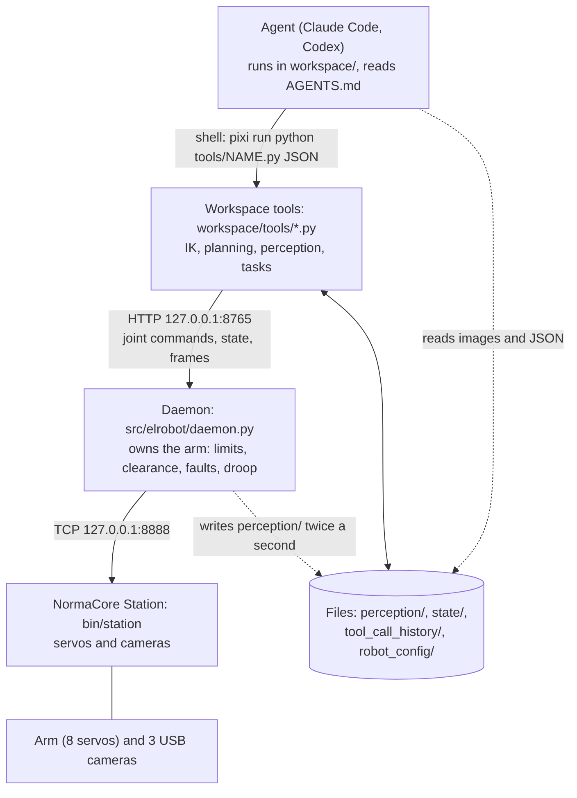
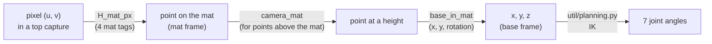
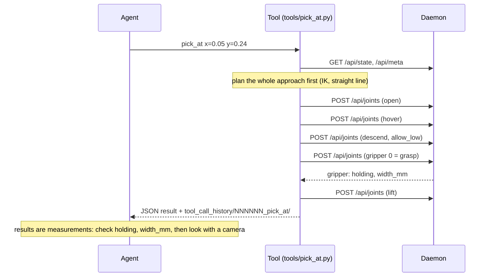

# Interfaces

The contracts between the parts: what an agent can call, what a tool is, what crosses to the robot, and what
the files on disk mean. For the daemon's full HTTP and WebSocket contract see `docs/API.md`; for the agent's
working rules see `workspace/AGENTS.md`. Last updated 2026-11-22.

## Layers



Only joint commands, state reads and camera frames cross from the tools to the daemon.

## Units and frames

- Metres and radians. Angles in tool arguments are degrees and say so (`yaw_deg`, `pitch_deg`). Gripper opening is 0 (closed) to 1 (open, 53 mm).
- **Base frame:** origin on the table under the base, x to the robot's right, y forward, z up. `table_z` (0.010) is the mat's surface.
- **Tool point (TCP):** between the finger pads, 12 mm back from the fingertips. Tool z is the approach direction, tool x the jaw closing axis.
- **Mat frame:** origin at tag 6, x towards tag 10, y towards tag 11, on the mat surface. Only calibration uses it.
- `yaw_deg` 0 closes the jaws left-right; `pitch_deg` 90 points straight down.

The base frame as the top camera sees it (drawn from the saved calibration onto a live frame, 2026-11-22):


How a pixel becomes a position the arm can go to:



`H_mat_px` and `camera_mat` are refitted by `tools/calibrate_top.py` whenever the camera moves. `base_in_mat`
is not: if the robot or the mat moves, it has to be measured again (see `docs/DECISIONS.md`).

## A workspace tool

A file `workspace/tools/NAME.py` defining `def NAME(ctx, ...) -> dict`, ending with `run_cli(NAME)`. Its module
docstring is its description (`--schema` prints it). Adding a file adds a tool.

```bash
pixi run python tools/NAME.py '{"x": 0.1}'     # arguments: one JSON object
pixi run python tools/NAME.py --schema
```

`ctx` (`tools/util/cli.py`):

| Member | What |
|---|---|
| `ctx.arm` | `util/arm.py` `Arm`: `state()`, `meta()`, `q()`, `limits()`, `frame(camera)`, `joints(path, gripper=, speed=, check=, allow_low=, label=, retry_blocked=)`, `torque(bool)`, `stop()` |
| `ctx.plan` | `util/planning.py` `Planner`: `fk`, `solve`, `reach`, `line`, `approach_for`, `blocked`, `table_z` |
| `ctx.frame(camera)` | newest BGR frame |
| `ctx.save_image(name, img, caption)`, `ctx.save_json(name, obj)` | into this call's history folder |
| `ctx.call(other_tool, **args)` | run another tool inside this call |
| `ctx.root`, `ctx.history` | workspace root; this call's folder |

Result: JSON on stdout. Exit status 1 when it contains `error`, with `error_kind` `robot` (something to act on)
or `tool_bug` (a crash, with `traceback`). Every result also carries `history`, `joint_command_count`,
`duration_s`, and `images` / `nested_calls` when there are any. There is no generic success flag: read the
tool's own fields. Raise `util.arm.RobotError` for anything the caller should act on.



Each call leaves `tool_call_history/NNNNNN_NAME/` with `input.json`, `result.json`, `joint_commands.jsonl`
and its images. A capture's folder name is its `image_id`.

## The joint command (tool to daemon)

`POST /api/joints`

```json
{"path": [[7 angles], ...], "gripper": 0.0, "speed": 0.8, "check": true, "allow_low": false,
 "label": "descending", "source": "agent", "call_id": "..."}
```

- `path`: one or more waypoints, travelled in straight joint-space segments under one speed profile. Optional if `gripper` is given.
- `gripper`: applied after the arm arrives. 0 is a grasp: the jaws close until they stall.
- `check: false` skips the clearance envelope; `allow_low: true` lets the fingertips reach the table surface.
- Returns `{"ok": true, "joints": [...], "gripper": {"open", "width_mm", "holding"}, "tcp": {"pos", "quat", "approach"}}`, or `{"ok": false, "error": "..."}` with the reason: outside limits, outside the envelope, blocked joint, servo fault.
- The call returns when the motion has finished. `POST /api/stop` halts a motion; killing the caller does not.

The daemon tries nothing twice. `Arm.joints` does, for one error: a move answered with `blocked: ...` is sent
once more as a second `POST /api/joints`, with the waypoints still ahead of where the arm stopped, `speed`
multiplied by `blocked_retry_speed` (never below 0.05, the daemon's floor) and `label` ending in
`(again, slower)`. If that goes through, the result carries `retried_blocked`: the first refusal's text. If
not, the second error is raised. `retry_blocked=False` on a call switches it off for that call.

`workspace/robot_config/motion.json`:

| Key | Meaning |
|---|---|
| `blocked_retry_speed` | Fraction of its speed at which a blocked move is sent again, 0 to 1. Default 0.5; 1 is the same speed again; 0 is no second try. Missing file or key: 0.5. Anything else: no second try, and the error says why. Read each time a move is blocked. |
| `note` | The same in words, for whoever opens the file. Not read. |

Reads: `GET /api/state` (`connected`, `calibrated`, `torque`, `joints[]` with `q`, `lower`, `upper`, `load`,
`temp`, `error`; `gripper`; `ee`; `cameras[]` with `name`, `width`, `height`, `age_ms`), `GET /api/meta`
(`mode` real or sim, `table_z`, `clearance`), `GET /api/camera/{name}/frame.jpg`. Also `POST /api/torque`,
`POST /api/event` (display only).

## Cameras

| Name | What | Calibration file |
|---|---|---|
| `top` | UGREEN webcam about 79 cm above the mat; the camera to measure with | `workspace/robot_config/camera_top.json` |
| `wrist` | KD camera on the gripper | `workspace/robot_config/camera_wrist.json` (copy of `data/camera_wrist.json`) |
| `across` | KD camera across the table, the former `top`; no tool uses it | `camera_top.kd-backup.json` (its old fit) |

Names are assigned in `config.yaml` by camera id; the two KD cameras share a model, so their ids include
bus:device and change when replugged (`scripts/probe.py` prints them). Frames are 853x480 at about 15 fps.

`camera_top.json`:

| Key | Meaning |
|---|---|
| `H_mat_px` | 3x3 homography, pixel to mat surface (metres) |
| `P_px_mat` | 3x4 projection, mat (x, y, height) to pixel |
| `camera_mat` | camera position in the mat frame |
| `base_in_mat` | where the robot's base is on the mat: x, y (m), rotation (deg). Not fitted by `calibrate_top`; see `docs/DECISIONS.md` |
| `tags_px`, `image_size` | tag centres and frame size at calibration |

`camera_wrist.json`: pinhole `fx fy cx cy`, distortion `k1 k2`, at `width` x `height`, mounted by
`rvec_tool_cam`, `t_tool_cam` in the tool frame.

## Files an agent reads and writes

| Path | Written by | Content |
|---|---|---|
| `perception/latest.json`, `perception/exteroception/{top,wrist}/rgb.jpg`, `perception/proprioception/state.json` | daemon, twice a second | newest state and frames |
| `perception/exteroception/objects.json` | `find_objects` | last object listing |
| `perception/exteroception/tracks.json`, `tracks.jpg`, `intrusion.*` | the tracker process | live tracks and the last alarm |
| `state/chess.json` | chess tools | board corners, heights, moves, appearance model |
| `state/drawing.json` | drawing tools | strokes, sheet corners, pen offset, progress |
| `.runtime/active_skill` | `activate_skill` | the skill in use |
| `tool_call_history/` | every tool call | the record |

## Tool reference

Signatures as of 2026-11-22; `--schema` on a tool is always current.

| Tool | Arguments | What it does |
|---|---|---|
| `activate_skill` | `name: str = ''` | Take up a skill: get its instructions, and note it as the one in use. |
| `adjust_tcp` | `dx: float = 0.0, dy: float = 0.0, dz: float = 0.0, frame: str = 'base', speed: float = 0.5, allow_low: bool = False` | Nudge the tool point by a small offset in a straight line, keeping the gripper's direction. |
| `calibrate_top` | `frames: int = 30` | Fit the top camera to the mat from the four corner tags. |
| `capture_camera` | `camera: str = 'top', grid: bool = True` | Take a still from a camera and freeze it with what is needed to measure in it. |
| `chess_move` | `move: str, even_if_not_my_turn: bool = False` | Play a chess move on the board with the arm, check it with the camera, and record it. |
| `chess_record` | `move: str \| None = None, undo: bool = False` | Record a chess move in the tracked game without moving anything, or take the last one back. |
| `chess_see` | `record: bool = True, close_up: str \| None = None` | Look at the chessboard: find the move the human just played, and show the board. |
| `chess_setup` | `king_height: float, image_id: str \| None = None, corners_px: list \| None = None, corners_xy: list \| None = None, board_height: float = 0.0, robot_color: str = 'black', fen: str \| None = None, captured_side: str \| None = None, snap: bool = True` | Tell the workspace where the chessboard is and start a game from the position on it. |
| `close_gripper` | - | Close the jaws on whatever is between them and report whether something stopped them. |
| `deactivate_skill` | - | End the skill in use, when its task is finished or abandoned. |
| `draw_pen` | `corners: list \| None = None, grip: bool = False, release: bool = False, seat_height: float = 0.05` | Say where the sheet of paper is, and take hold of the pen so its tip is known. |
| `draw_plan` | `image_path: str \| None = None, image_id: str \| None = None, quad_px: list \| None = None, strokes: list \| None = None, invert: bool = False, detail: float = 0.004` | Decide what to draw: turn a picture into pen strokes, or take strokes you wrote yourself. |
| `draw_run` | `margin: float = 0.015, pen_up: float = 0.015, press: float = 0.001, speed: float = 0.3, first_stroke: int = 0, dry_run: bool = False` | Draw the planned strokes on the sheet with the pen in the gripper. |
| `find_objects` | `camera: str = 'top', max_objects: int = 8` | Outline, number and locate whatever stands out on the table, seen by a camera. |
| `home` | `speed: float = 0.5` | Go to the ready pose: gripper over the table in front of the base, pointing down and forward. |
| `joint_command` | `joints=None, gripper: float \| None = None, speed: float = 0.8, check: bool = True, allow_low: bool = False` | The atomic action, and the only thing the robot understands: joint angles. |
| `look_at_table` | `x: float = 0.0, y: float = 0.14, height: float = 0.09, pitch_deg: float = 80.0, speed: float = 0.8` | Bring the wrist camera over a spot on the table for a close look, and capture what it sees. |
| `move_tcp` | `x: float, y: float, z: float, pitch_deg: float \| None = None, yaw_deg: float \| None = None, straight: bool = False, speed: float = 0.8, allow_low: bool = False` | Move the tool point (the spot between the fingertips) to x, y, z. |
| `open_gripper` | `fraction: float = 1.0` | Open the jaws to `fraction` of full travel: 1 = fully open (53 mm), just above 0 = nearly shut. |
| `pick_at` | `x: float, y: float, yaw_deg: float \| None = None, grasp_height: float = 0.022, refine: bool = False` | Pick up the object at table position x, y: the whole grasp, built from joint commands. |
| `pick_object` | `object: str, grasp_height: float \| None = None, attempts: int = 4` | Pick up a tracked object by name, wherever it is by the time the gripper gets there. |
| `pick_verified` | `x: float, y: float, yaw_deg: float \| None = 0.0, grasp_height: float = 0.022, object_height: float = 0.025, corrections: int = 2, tolerance_mm: float = 8.0` | Pick up the object at x, y with the wrist camera checking the grasp before and after. |
| `pixel_to_table` | `image_id: str, u: float, v: float, height: float = 0.0` | Turn a pixel of a frozen capture into a position in the robot's frame. |
| `place_at` | `x: float, y: float, z: float = 0.0, yaw_deg: float \| None = None` | Put down what the gripper holds at table position x, y, then back away. |
| `place_object` | `object: str = '', on: str = '', x: float \| None = None, y: float \| None = None, z: float \| None = None, yaw_deg: float \| None = None, attempts: int = 4, retries: int = 1` | Put what the gripper holds onto a tracked object, or at x, y, and check where it ended up. |
| `plan_grasp` | `object: str \| int \| None = None, x: float \| None = None, y: float \| None = None, footprint_mm: list \| None = None, yaw_deg: float = 0.0, height_mm: float \| None = None, obstacles: list \| None = None, pick: bool = False, attempts: int = 3` | Work out the best way to grasp an object, considering what stands around it; optionally do it. |
| `read_proprioception` | - | Report the measured robot state and draw the body's current posture. |
| `rest` | - | Fold the arm into its resting seat and switch the motors off. |
| `stop` | - | Halt all motion now and hold position. Always allowed, even while another tool is running. |
| `track_objects` | `action: str = 'read', stop_arm_on_intrusion: bool \| None = None` | Live tracking of what is on the table: read it, and start or stop it. |

## Testing without a robot

`workspace/tests/` holds tests of workspace code that need neither arm nor simulator: `util.arm._request` is
replaced by a fake daemon that answers from a list (`test_blocked_retry.py`). They run in the workspace's own
interpreter: `cd workspace && uv run --with pytest pytest -q tests`. The root `pytest` keeps to `tests/`.

## Testing against the simulator

`tests/test_workspace.py` shows the pattern: copy `workspace/` to a temp folder, start `create_app(Config(sim=True, ...))`
on a free port in a thread, set `ELROBOT_DAEMON`, and call tools in-process with `util.cli.call`. The simulated
world's blocks (`elrobot.simworld.Block`) can be replaced by a test. Never point a test at port 8765: that is the real arm.
