# Plan to the final submission

Final submission: 2026-11-22, about 14:00 (ten hours from 04:05, when this plan was made).
Tick items off here as they land; put the name of whoever takes one after it. What already works is in
`docs/FEATURES.md`.

## What the demo has to show

| # | Requirement | Demo | Work needed | Status |
|---|---|---|---|---|
| 1 | Multiple tasks | Sort cubes by colour, stack them, draw with a marker | Drawing has only run in the simulator: about 2 h on the real arm | pick and place work on the real arm; drawing open |
| 2 | Zero-shot | "Put the blue cube on the pink box", "push the cube to the corner", "wave" | None; record the runs | to record |
| 3 | Failure recovery | Take the cube away mid-reach, or nudge it; the arm re-aims and retries. Also: a move stopped as blocked goes through on a slower second try | None; `pick_object` and `pick_verified` already do the first, `Arm.joints` the second | to record; `pick_object` not re-run since the camera change |
| 4 | Automatic skill creation | After a zero-shot task the agent writes a new `skills/<name>/SKILL.md`; a second run uses it | About 30 min for a `create_skill` tool and an instruction line | open |
| 5 | Code-as-policy | "Lay the cubes in a line every 5 cm", "draw a spiral": the agent writes a Python script against the planner | None; the workspace already works this way | to record |
| 6 | One-shot / few-shot | Move the limp arm through a motion once; it records and replays it | About 1.5 h for `record_demo` and `replay_demo` | open |

## Order of work

```mermaid
gantt
    dateFormat HH:mm
    axisFormat %H:%M
    title 2026-11-22, times are a guide
    section Perception
    Name objects by what they are   :a1, 04:30, 60m
    World model above the tracker   :a2, after a1, 90m
    section Demo features
    create_skill tool               :b1, after a2, 30m
    record_demo and replay_demo     :b2, after b1, 90m
    Drawing on real paper           :b3, after b2, 120m
    section Recording
    Zero-shot, recovery, code-as-policy runs :c1, after b3, 60m
    Rehearse and record the final take       :c2, after c1, 60m
    Write-up and submit                      :c3, after c2, 45m
```

That fills the time to about 13:45 with no slack. If something overruns, drop from the bottom of "If time
remains" first, then drawing on real paper (requirement 1 still holds with sort and stack).

## To do

### Must have

- [x] **Name objects by what they are.** Done: `describe_objects`, `name_objects`. Was: A tool that makes one numbered sheet of close-up crops (top and wrist
      cameras); the agent names each ("blue cube", "rubber ring") and the names are stored. About 1 h.
- [x] **World model** (`state/world.json`), done with `world_model`, `grasp_object`, `put_object`; simulator only for the motion. Was: above the tracker: name and class, height, graspable width, shape,
      relations (on, in, next to), and what was tried on each object with its outcome. About 1.5 h.
- [ ] **Try safe mode on the real arm:** `home`, then pick and place a cube inside the straight-down area
      (within 16 cm either side of the base, 12 to 24 cm in front). The objects now on the table at y > 0.26
      will be refused as too far: that is the intended behaviour, move them closer.
- [ ] **Re-run `track_objects`, `pick_object`, `place_object` on the real arm** with the new top camera and the
      refitted `base_in_mat`. Needed for requirement 3. About 20 min.
- [x] **`create_skill` tool** (done) and a line in `workspace/AGENTS.md` telling the agent to write a skill after a task
      it had no skill for. Requirement 4. About 30 min.
- [ ] **`record_demo` / `replay_demo`**: torque off, a person moves the arm, joint angles and jaw are recorded;
      replay as joint commands. Requirement 6. About 1.5 h.
- [ ] **Record the zero-shot runs** (requirement 2): cube onto the pink box, push to a corner, wave.
- [ ] **Record the failure-recovery runs** (requirement 3): cube taken away mid-reach; cube nudged.
- [ ] **Record the code-as-policy runs** (requirement 5): cubes in a line every 5 cm; keep the script the agent wrote.
- [ ] **Final take, write-up, submit.** Decide who edits the video and who writes the text.

### Should have

- [ ] **Drawing on real paper** (`draw_plan`, `draw_pen`, `draw_run`): simulator only so far. Expect to tune
      `press`. About 2 h. Requirement 1.
- [ ] **Rings and hollow objects** (detection and rim grip written; **try `grasp_object` "the ring" on the real arm**): notice the hole and grip the rim, so a rubber ring is not grasped at its
      empty centre. Small, once objects have a shape in the world model.
- [ ] **Merge `idea-1-arav` into `main`** (or agree which branch is submitted).

### If time remains

- [ ] **Noughts and crosses** on a taped 3x3 grid of 6 cm cells, reusing the chess code's structure. About 1 h.
      Full chess is not planned: squares are 3 cm and the arm is 1 to 2 cm off beyond 30 cm.
- [ ] **Local open-vocabulary detector and segmenter** on the laptop's RTX 5060 ("find the ring", real masks,
      black and mat-coloured objects). 2 to 3 h, with install risk; keep it behind a flag.
- [ ] **Top camera position:** the estimate (79 cm up) is probably off, so the arm's own parts show up as grey
      objects in `find_objects`. Proper fix is lens intrinsics with `scripts/calibrate_camera.py`.
- [ ] **30 fps:** `frame-skip: 0` in `station/station.yaml` doubles the stored frame rate and the disk writes.

## Done (2026-11-22, early hours)

- [x] Chess, drawing and `plan_grasp` tools and skills, passing in the simulator
- [x] UGREEN webcam as the top camera, recalibrated from the mat tags
- [x] `base_in_mat` refitted (was 2.2 cm and 4.8 degrees off)
- [x] Wrist-camera calibration from `main` merged and in use; cameras at 1280x720
- [x] `pick_verified`: wrist camera checks before and after; blue cube picked three times on the real arm
- [x] `scripts/cameras_ready.sh`
- [x] Docs: FEATURES, DECISIONS, INTERFACE, this plan
- [x] Chat box and microphone drive the workspace agent; speech in and out on Linux (Parakeet v3, Phonon);
      English, French and German
- [x] Safe mode: straight-down grasps, straight-line travel, too-far objects refused (simulator only so far)
- [x] Web UI camera panel: switch between all cameras; live layers for objects, tags, robot frame, arm, tool results
- [x] A blocked move is tried once more, slower (`blocked_retry_speed` in `workspace/robot_config/motion.json`,
      default 0.5); tests in `workspace/tests`. Not yet seen on the real arm

## Keep the setup alive

- Do not move the top camera, the mat or the robot's base. If one moves: `tools/calibrate_top.py` for the camera,
  and `base_in_mat` has to be measured again (see `docs/DECISIONS.md`).
- Before any Station start: `scripts/cameras_ready.sh`, then `pixi run up`. Frames of 640x480 mean it was skipped.
- A servo overload (status 32) needs a person to hold the arm while torque is cycled. Keep objects 15 to 30 cm
  in front of the base: closer is refused, further is inaccurate.
- `rest` the arm between takes; a stretched arm is hard on the shoulder servo.
- No sound from the web UI and "Could not open the microphone", while the chat still answers in text: the
  desktop's audio server has stalled (it did once on 2026-11-22, after the cameras were replugged and the Station
  restarted several times). `systemctl --user restart wireplumber pipewire pipewire-pulse`, then reload the page.
  The laptop's "Digital Microphone" delivers nothing on this machine; the UGREEN camera's microphone is the one
  that works and should be the default input.
