# What was seen and measured on 22 November 2026

Pictures and numbers from the afternoon on the real table: the ElRobot, the SO-101 beside it, the top camera,
the two wrist cameras and the Orbbec depth camera across the table. What each part is and how to run it is in
`docs/SECOND_ARM.md`; this page is the record. Every picture is from the real setup.

## The web UI and the digital twin

Both arms in one 3D view, each moving with its real joint angles. The ElRobot is yellow with its wrist camera
dark on the gripper; the SO-101 is dark with orange jaws. The labels are the heights of the things the depth
camera found in the last scan.

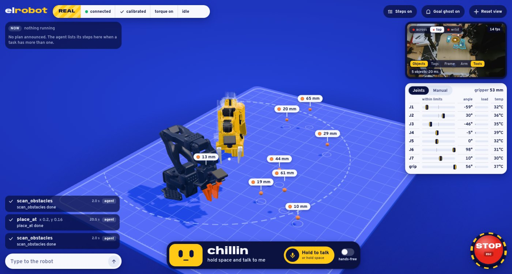

A hand-over that failed, as the UI shows it: the timeline entry turns red with the tool's own words, and the
twin shows where the two grippers stood, the SO-101's jaws at the ElRobot's fingers.

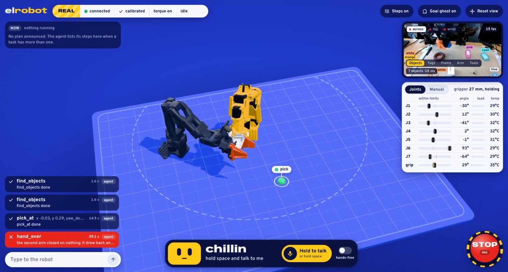

The camera panel enlarged, on the top camera, with its layers switched on: detected objects, the mat's corner
tags, the robot's frame and reach, the arm's joints.

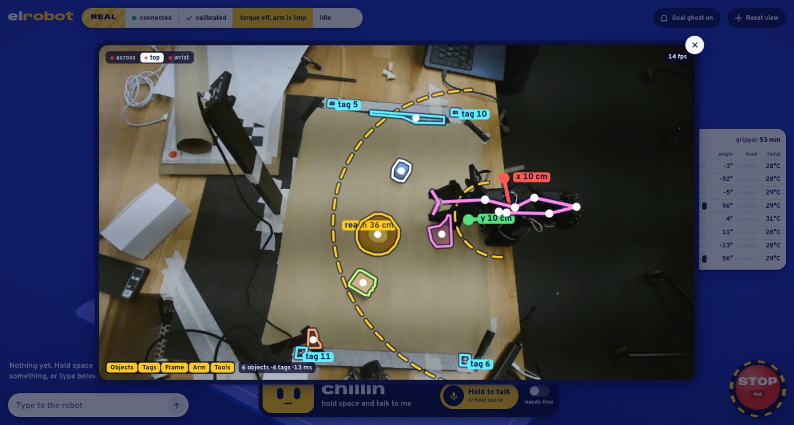

## Camera views

| Top camera (above the mat, the one that measures) | Across (the depth camera's colour picture) | Wrist (ElRobot) |
|---|---|---|
| 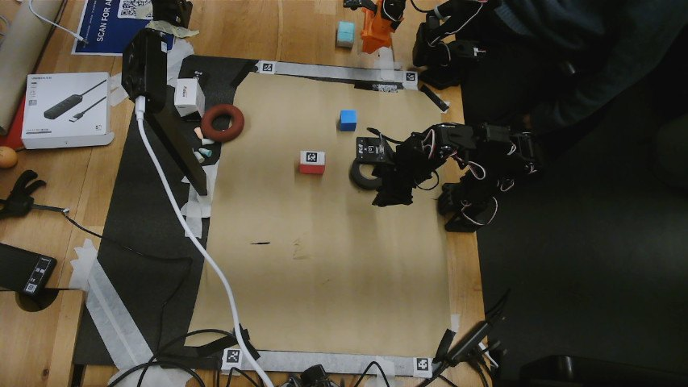 | 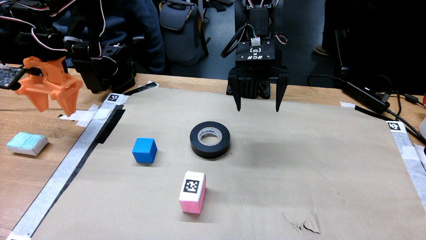 | 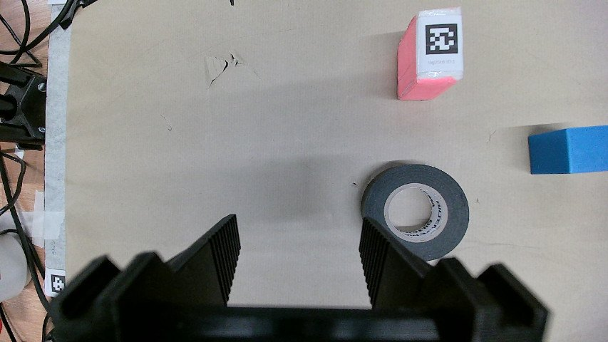 |

## The depth camera

The raw depth picture, 640x400, near to far from blue to red; black is where the sensor saw nothing. The mat
is the large flat area, the two arms stand at its far edge.

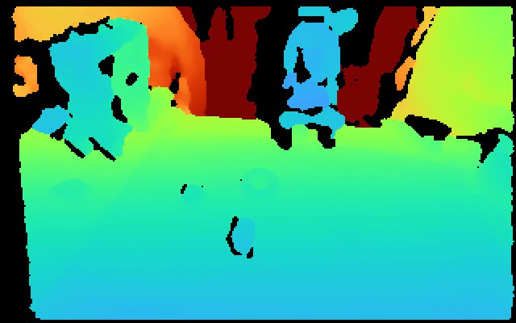

Calibration: the mat's plane from the depth picture gives height and tilt, the two corner tags on the robot's
side (circled in the camera's colour picture) give the rest.

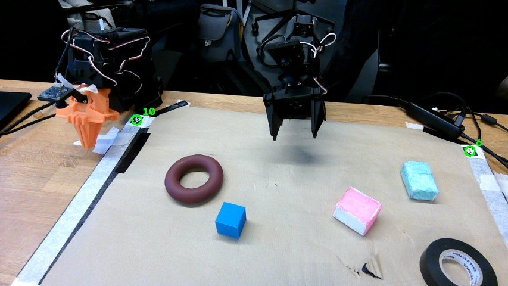

| Measure | Value |
|---|---|
| Tags fitted | 2 (ids 6 and 10), to 1.0 mm each, 0.6 mm after the camera was turned |
| Distance between the tags, measured against the ruler's 585 mm | 2 mm off |
| Flatness of the mat in the depth picture | 1.6 to 1.8 mm |
| Camera position in the base frame | x 0.047, y 0.493, z 0.362 m |
| A 30 mm cube | read 29 mm |
| The pink block (27 mm) | read 27 mm |
| A scan | about 2 s |

The first height map (12:19): the table from above, the base at the bottom, coloured by height. The arm over
the mat is the red patch.

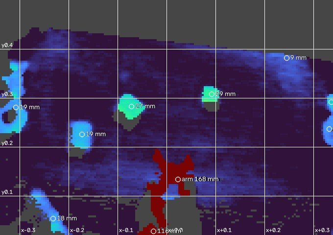

Positions against the top camera's, same objects, same moment:

| Object | Top camera x, y (m) | Depth camera x, y (m) | Apart | Height, top camera | Height, depth |
|---|---|---|---|---|---|
| blue cube | 0.085, 0.305 | 0.091, 0.308 | 7 mm | 29 mm | 29 mm |
| pink block | -0.082, 0.279 | -0.072, 0.284 | 11 mm | 28 mm | 27 mm |
| cyan sponge | -0.180, 0.223 | -0.173, 0.226 | 8 mm | 33 mm | 19 mm |

The depth camera reads about 8 mm further right than the top camera. On the sponge's height the two disagree;
the depth camera's is the direct measurement.

### Which things can be picked, from the depth map

The height map at the end of the afternoon, and the same map with the ElRobot cut out and each thing marked by
which arm could pick it: within the ElRobot's 36 cm or the SO-101's 30 cm, at least 15 mm tall, and at most
48 mm across its narrow side (the jaws open 53 mm).

| Heights | Pickable by |
|---|---|
| 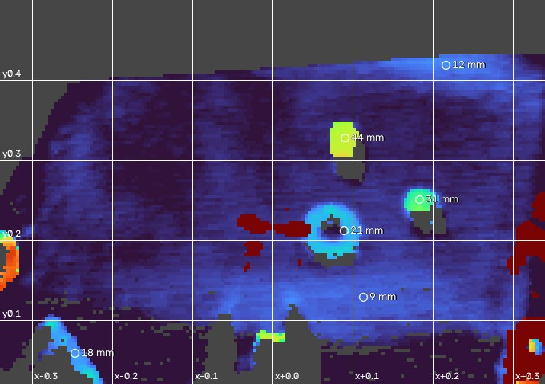 | 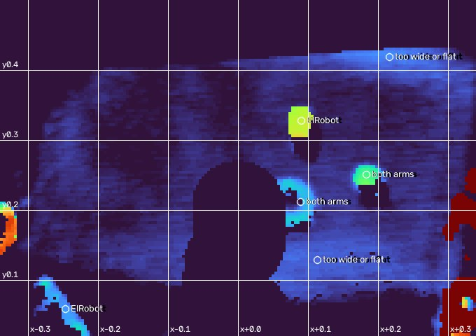 |

| x (m) | y (m) | Height (mm) | Size seen (mm) | Pickable by |
|---|---|---|---|---|
| 0.090 | 0.328 | 44 | 40 x 32 | ElRobot (the pink block, on its side) |
| 0.183 | 0.251 | 31 | 36 x 28 | both arms (the blue cube) |
| 0.089 | 0.212 | 21 | 68 x 46 | both arms (the ring; its 46 mm is the rim seen, a ring is gripped by the rim) |
| -0.247 | 0.060 | 18 | 106 x 29 | ElRobot (a cable at the mat's edge, not an object) |
| 0.216 | 0.420 | 12 | 160 x 40 | too wide or flat |
| 0.113 | 0.129 | 9 | 152 x 51 | too wide or flat |

This marking is made from height and size alone, and it shows: it takes a cable for an object. The names in
brackets are from looking at the colour picture.

## Obstacles, and the moves that were refused

What `scan_obstacles` keeps: the height map with both arms cut out (the two dark patches), each thing with
its height.

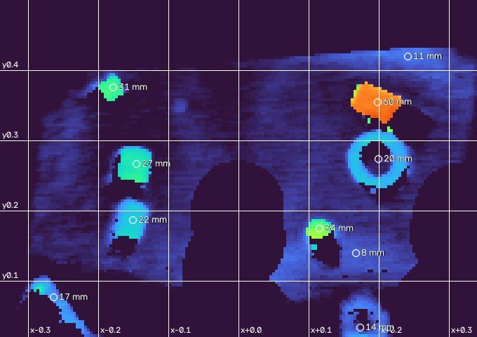

The refusals, in the tools' own words:

| When | What was asked | The answer |
|---|---|---|
| test, 14:27 | ElRobot to the SO-101's gripper | `not moving: on the way this arm's gripper and the second arm's gripper would come within 18 mm of each other. Move the second arm away first (tools/second_arm.py), or go another way.` |
| 14:44 | ElRobot carries the sponge past the fallen pink block | `not moving: on the way this arm's gripper would hit the thing 47 mm tall at x=+0.078 y=+0.250. Go over it or another way; if it has been moved since, scan again (tools/scan_obstacles.py).` |
| 15:10 | SO-101 to the cube while the ElRobot rests with its gripper over the mat | `second arm not moving: on the way this arm's gripper and the second arm's wrist camera would come within 19 mm of each other. Move this arm away first (home or rest), or go another way.` |
| 15:17 | SO-101 from home to the cube, past the ring | `second arm not moving: on the way the second arm's gripper would hit the thing 21 mm tall at x=+0.222 y=+0.246. Go over it or another way; if it has been moved since, scan again (tools/scan_obstacles.py).` |

The carry at 14:44 went through after the lift-over rule was added (three waypoints: up, across, down), and
the SO-101's move at 15:17 after it got the same rule.

Other errors met on the way:

| Error | Cause | What was done |
|---|---|---|
| Depth stream stops after three pictures | the kernel's 16 MB limit on USB transfer memory, shared with the Station's three cameras | raised to 256 MB (`scripts/orbbec_setup.sh` says how) |
| No Orbbec device found | the current SDK does not know this sensor's protocol; the old one's Linux wheel holds macOS libraries | the old SDK built from source |
| Wrist camera at 640x480 after a replug (Station error -51) | the camera refuses 1280x720 until it has streamed it once through the kernel driver | `scripts/cameras_ready.sh` does that |
| `the second arm closed on nothing` | jaws 14 to 17 mm too low: rising, the SO-101 stops short | corrected from its own joint readings |
| `HTTP 500 for /api/joints` | a command to the Station timed out once | sent again |
| `second arm, home: blocked: joint 1 is 42 deg behind` | the SO-101 ran into the tape roll on the table | the collision and obstacle checks came after this |
| A crash on every ElRobot move with the SO-101 unplugged | the collision check read an empty joint list | fixed: an unplugged second arm is skipped |

## The hand-over

The ElRobot holds the cube by its top; the SO-101 comes up from below and closes on the lower half. Above, a
grip that missed (the jaws beside the cube); below, one that worked. Left the front view, right the ElRobot's
wrist camera looking down past its fingers.

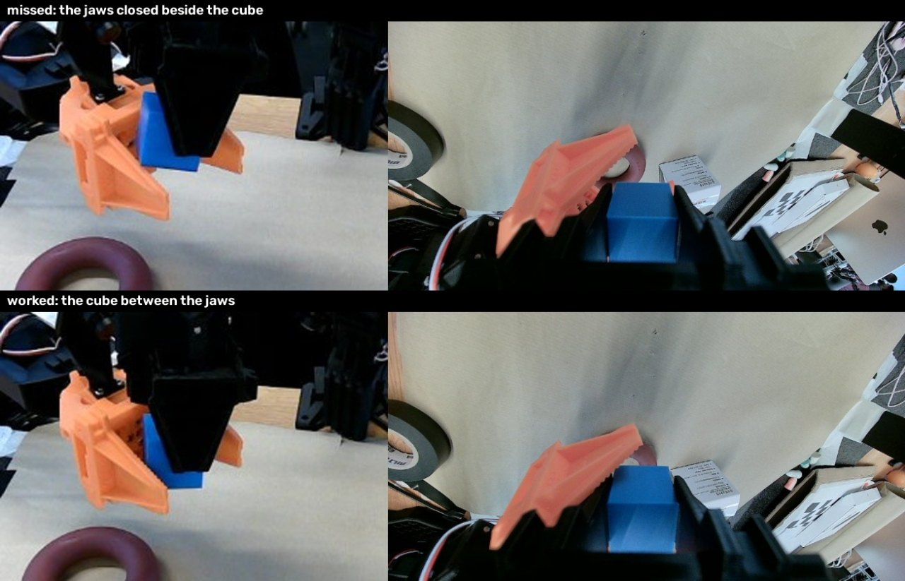

Done: the SO-101 holds the cube, the ElRobot is back at home with its gripper empty.

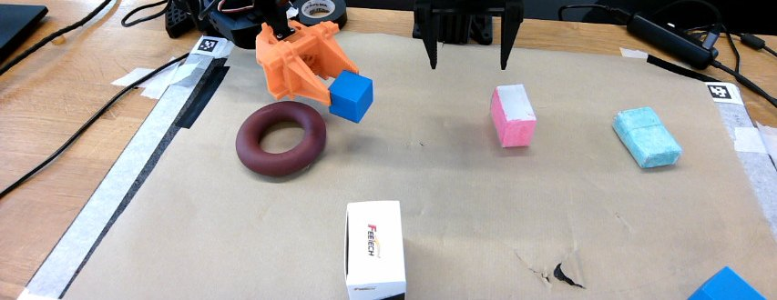

From the poses shown by hand, the arms meet nose to nose. The ElRobot's wrist camera after it let go and drew
back: the cube in the SO-101's orange jaws.

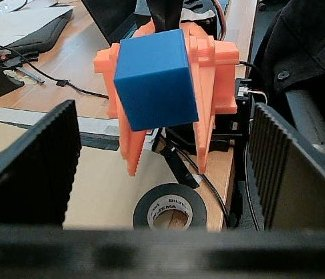

| Stage | Method | Unattended runs that worked |
|---|---|---|
| Before the SO-101's height was corrected | computed from the depth camera | 0 of 3 |
| After | computed | 2 of 2 |
| | one pose adjusted by pushing the ElRobot | 1 of 2 |
| | poses shown with both arms limp | 4 of 6 |

| What limits it | Size |
|---|---|
| Room each side of a 30 mm cube in jaws that open 53 mm | 11 mm |
| Fit of the SO-101's position (six places, in the air) | 4 to 8 mm |
| SO-101 stopping short when it rises | 8 to 18 mm, corrected to within 5 mm |
| ElRobot returning to a shown pose | 2 mm, once 17 mm |
| SO-101 returning to a shown pose | 1 to 2 mm |
| How the cube sits in the ElRobot's fingers | about 10 mm |
| One hand-over | 53 to 80 s |

## Stacking with the second arm

Not achieved. The SO-101 was to pick the cube off the mat and set it on the sponge. Where its joints say its
jaws are is 2.5 to 4.5 cm from where they are at the table, so the top camera corrects it. This is what that
camera has to go by: the gripper (circled where the joints put it) is mostly under its own camera, and only a
sliver of orange shows.

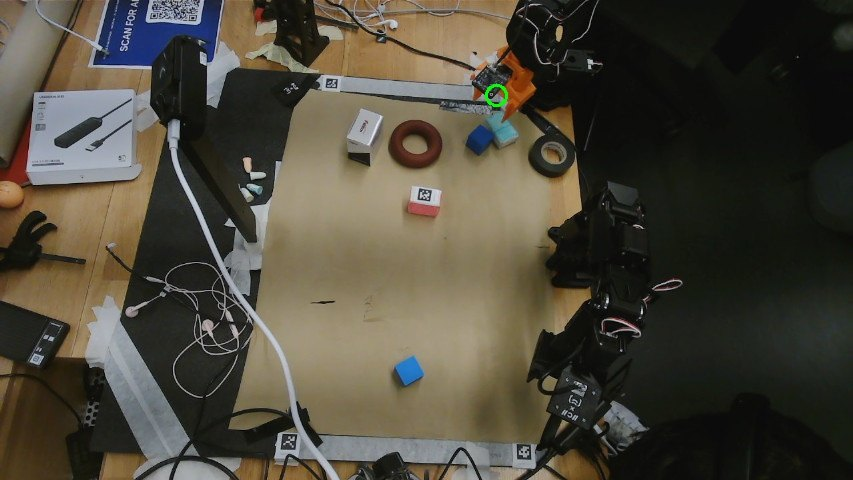

The result of the better of the two placings: the cube beside the sponge, leaning on it.

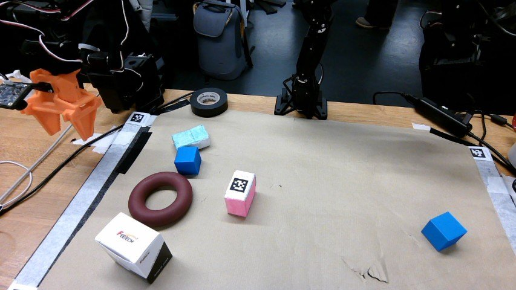

| Step | Result |
|---|---|
| Pick the cube off the mat, by its joints alone | 0 of 1 |
| Pick, with the top camera correcting | 2 of 3; the jaws were 11, 7, 11, then 2 mm off before the pick that worked |
| Set it on the sponge | 0 of 2 |

## The run log

Every calibration, hand-over and stacking call of the afternoon, from the call history
(`workspace/tool_call_history/`, not in the repository). The early hand-over failures are the tool being
built: no reachable spot, the pink block hidden in the fingers, the SO-101 with no level pose near its base.

| Time | Tool | Method | Result | Seconds | Detail |
|---|---|---|---|---|---|
| 12:18 | calibrate_depth | - | done | 4.44 | {"tag_fit_mm": [1.0, 1.0], "flatness_mm": 1.58, "camera_base": [0.041, 0.486, 0.363]} |
| 12:48 | calibrate_depth | - | done | 4.36 | {"tag_fit_mm": [0.6, 0.6], "flatness_mm": 1.79, "camera_base": [0.047, 0.493, 0.362]} |
| 12:58 | calibrate_second_arm | - | done | 68.59 | {"miss_mm": [6.0, 7.2, 7.9, 4.1, 7.8, 5.5], "places_used": 6, "left_out": 4, "second_arm_base": [0.286, 0.013, 0.039]} |
| 13:02 | hand_over | - | failed | 0.93 | no spot in front of the second arm that this arm reaches pointing down: are the two arms within 35 cm of each  |
| 13:03 | hand_over | - | failed | 33.56 | the depth camera sees nothing pink in this arm's gripper: is it holding the thing, and is that its colour? |
| 13:05 | hand_over | - | failed | 23.67 | the second arm could not take it (second arm, move_to: can't reach (-0.175, 0.127, 0.123): pos_err=6.8mm ang_e |
| 13:06 | hand_over | - | failed | 29.09 | the second arm could not take it (second arm, move_to: can't reach (-0.212, 0.151, 0.125): pos_err=3.3mm ang_e |
| 13:09 | hand_over | - | failed | 22.38 | the second arm could not take it (second arm, move_to: can't reach (-0.145, 0.158, 0.167): pos_err=3.7mm ang_e |
| 13:10 | hand_over | - | failed | 39.79 | the second arm closed on nothing; it drew back and this arm still holds the thing |
| 13:14 | hand_over | - | failed | 40.73 | the second arm closed on nothing; it drew back and this arm still holds the thing |
| 13:30 | hand_over | - | failed | 59.11 | the second arm closed on nothing; it drew back and this arm still holds the thing |
| 13:35 | hand_over | - | worked | 62.6 | gripped on try 1 |
| 13:38 | hand_over | - | failed | 58.95 | the second arm closed on nothing; it drew back and this arm still holds the thing |
| 13:44 | teach_hand_over | teach run | failed | 84.47 | the second arm closed on nothing three times ([{'height_m': 0.132, 'holding': False, 'width_mm': 0.1}, {'heigh |
| 13:46 | teach_hand_over | teach run | worked | 105.82 | gripped on try 1 |
| 13:49 | hand_over | - | failed | 0.0 | this arm is not holding anything: pick the thing up first |
| 13:49 | hand_over | - | failed | 12.07 | the robot daemon answered HTTP 500 for /api/joints: Internal Server Error |
| 13:50 | hand_over | adjusted pose | worked | 53.15 | gripped on try 1 |
| 13:52 | hand_over | - | failed | 57.34 | the second arm closed on nothing three times ([{'height_m': 0.124, 'holding': False, 'width_mm': 0.1}, {'heigh |
| 14:09 | hand_over | poses | worked | 53.68 | gripped on try 1 |
| 14:11 | hand_over | poses | worked | 55.26 | gripped on try 1 |
| 14:13 | hand_over | - | failed | 64.83 | the second arm closed on nothing four times ([{'offered_mm': 0, 'holding': False, 'width_mm': 0.1}, {'offered_ |
| 14:15 | hand_over | - | failed | 66.1 | second arm, home: blocked: joint 1 is 42 deg behind where it should be. Something is in the way or the load is |
| 14:32 | hand_over | - | failed | 24.18 | second arm not moving: on the way this arm's gripper and the second arm's wrist would come within 15 mm of eac |
| 14:33 | hand_over | - | failed | 49.47 | not moving: on the way this arm's gripper and the second arm's gripper would come within 0 mm of each other. M |
| 14:36 | hand_over | poses | worked | 79.98 | gripped on try 4, cube offered 30 mm |
| 15:10 | second_arm_stack | - | failed | 8.15 | second arm not moving: on the way this arm's gripper and the second arm's wrist camera would come within 19 mm |
| 15:10 | second_arm_stack | - | failed | 12.11 | the second arm closed on nothing at x=+0.115 y=+0.175: it is back above the place, jaws open. Look again where |
| 15:13 | second_arm_stack | - | cube set beside the base | 45.6 | jaws off before each shift, pick: [11, 7, 11, 2] mm; height measured 25 of 52 mm |
| 15:14 | second_arm_stack | - | cube set beside the base | 37.02 | jaws off before each shift, pick: [158] mm; height measured 32 of 52 mm |
| 15:17 | second_arm_stack | - | failed | 0.71 | second arm not moving: on the way the second arm's gripper would hit the thing 21 mm tall at x=+0.222 y=+0.246 |
| 15:20 | second_arm_stack | - | failed | 35.86 | the second arm closed on nothing at x=+0.110 y=+0.209 (the top camera had it [44, 12, 7, 12] mm off before eac |

## Tests

`cd workspace && uv run --with pytest pytest -q tests`: 35 passed.

The full simulator suite (`uv run --with pytest pytest -q`), run once the afternoon's changes were in, with
both real daemons running beside it: 56 passed and 1 failed in 10 min 43 s, stopping at the failure.
The failure is `tests/test_push_t.py::test_the_t_is_pushed_onto_its_target[start0-target0]`: the push ended
2.5 mm and 4 degrees from its target and the test's overlap measure came to 0.732 where it asks for more than
0.75. Whether the wrist camera, now a body part in the kinematics, changed that run was not looked into.

The files after it in the order (`test_robot_sim`, `test_second_arm`, `test_workspace`) and `test_kinematics`
were then run by themselves: 29 passed in 4 min 20 s. `test_vision_live`: 1 passed. So every test passes
except that one push.
