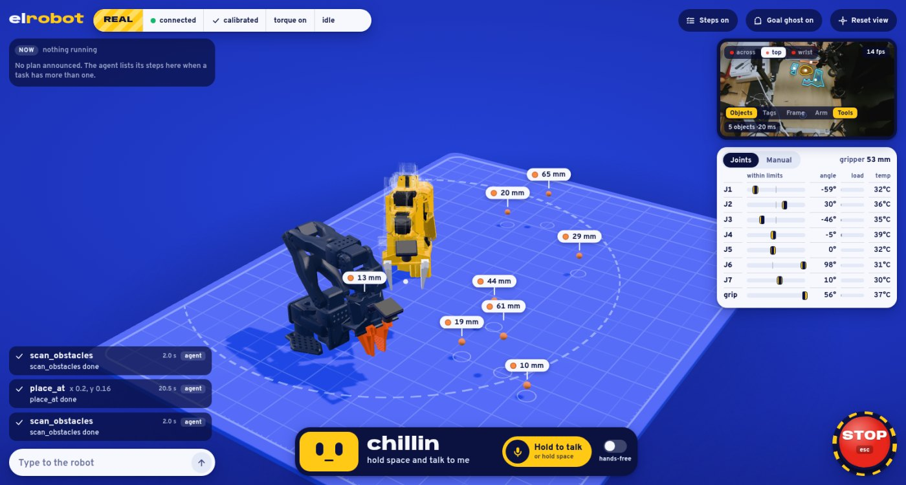

# Two arms on one table

The ElRobot shares its table with a second arm. The second arm is an SO-101 with the same parallel gripper and
the same wrist camera mount. The SO-101 stands 29 cm to the right of the ElRobot. This page tells you how to
start it, what the tools do, and how far each part is proven. The reasons are in `docs/DECISIONS.md`. The
history is in `docs/CHANGELOG.md`. The pictures and the full set of measurements are in `docs/RESULTS.md`.



## Start

Start both daemons in your own terminals. If you start the daemons from an agent session, they are ended after
two hours.

```bash
scripts/cameras_ready.sh && pixi run up     # Station, the ElRobot's daemon, web UI on :8765
scripts/second_arm_up.sh                    # the SO-101's daemon on :8770 (needs the Station running)
```

`scripts/second_arm_up.sh` checks out the `autopilot` branch of this repository beside this repository
(`../norma-core-5-so101`). Then the script runs that branch's daemon with its SO-101 profile. Nothing of that
branch is merged here. `config.yaml` names the ElRobot's servo bus (`bus_serial`), because the Station now has
two servo buses.

For the depth camera, run `scripts/orbbec_setup.sh` one time for each machine. The script builds Orbbec's SDK
into `bin/orbbec/` and lists the two root-only settings it needs.

## Calibrate, in this order

| What | Tool | Needs | Writes |
|---|---|---|---|
| Depth camera in the ElRobot's frame | `calibrate_depth` | two mat tags in the `across` view | `robot_config/camera_depth.json` |
| Where the SO-101 stands | `calibrate_second_arm` | a person hands the SO-101 the pink block | `robot_config/second_arm.json` |
| The hand-over, shown by hand (optional) | `record_poses` | both arms limp, a person moves them | `state/two_arm/hand_over.json` |

Run them again after a camera, the mat or an arm was moved.

## Tools

| Tool | What it does |
|---|---|
| `depth_scan` | heights of everything on the mat, and at given spots |
| `scan_obstacles` | keeps the height map as obstacles for both arms, for two minutes |
| `arms_clearance` | the smallest gap between the two arms right now |
| `second_arm` | the SO-101's `home`, `rest`, `move_to`, `move_joints`, `gripper`, `grasp`; positions in the ElRobot's frame |
| `hand_over` | the ElRobot passes what it holds to the SO-101 in the air |
| `teach_hand_over` | one hand-over adjusted by pushing the ElRobot |
| `record_poses`, `replay_poses` | poses shown with both arms limp, kept and played back |
| `second_arm_stack` | the SO-101 picks a thing off the mat and sets it on another thing |

## One space for both arms

`workspace/tools/util/shared_space.py` holds both arms in the ElRobot's base frame. Each arm is six capsules
(base, upper arm, forearm, wrist, gripper, wrist camera). The file holds the things on the table as the depth
camera's height map. Before a move is sent, a check follows the joint path of the move. The check tests the
path against the other arm where that arm stands and against the map:

- The check refuses a path that brings any part within 2 cm of the other arm. The refusal names the parts.
- The check refuses a path that moves a part down into something on the table. The refusal gives the height
  and the place of the thing.
- Around the place where a move starts and the place where it ends, the things on the table do not count. At a
  hand-over, the check lets the two hands meet.

This check covers every joint command of the ElRobot. It also covers the SO-101's `home`, `move_to` and
`move_joints`. When something stands on the way, `pick_at`, `place_at` and the SO-101's reach go up, across
above the tallest thing on the line, and down. The web UI's 3D view shows both arms, the scanned things as
columns and the path that an arm is about to take.

The check does not know what a gripper holds. It does not know an arm while that arm moves (one arm moves at a
time). It does not know the SO-101 daemon's own `pick`, `place` and gestures. It does not know anything that
the depth camera does not see. The check examines paths. Apart from the lift-over rule, it does not search for
another path.

## How far it is proven (real arms, 2026-11-22)

| Part | Result |
|---|---|
| Depth camera | tags fitted to 0.6 mm; a 30 mm cube read 29 mm; positions within about 1 cm of the top camera's |
| SO-101 calibration | six places fitted to 4 to 8 mm, in the air with level jaws; four more left out as over 15 mm off |
| Collision check, arm against arm | a move of the ElRobot at the SO-101's gripper was refused; a full pick and hand-over cycle went through |
| Obstacles and lift-over | a carry through a 47 mm block was refused, then went over it; the SO-101 went over the ring |
| Hand-over of a 3 cm cube, unattended | 0 of 3 before the SO-101's height was corrected; then 2 of 2 computed, 1 of 2 from one adjusted pose, 4 of 6 from poses shown by hand |
| Hand-over of the pink block | not possible: the ElRobot's wedge fingers cover it |
| Stacking by the SO-101 | not achieved: the SO-101 picked the cube 2 times in 4 and set it beside the base both times |

## Known limits

- **The SO-101 is 2.5 to 4.5 cm off at the table.** Its place was fitted in the air. When the SO-101 points
  down at the mat, its joints put it somewhere else. `second_arm_stack` corrects with the top camera. The top
  camera sees only a thin strip of the gripper under the gripper's own camera, and its reading varies by a
  centimetre. Either a fit at table level or a tag on the SO-101's camera mount would fix this. A fit at
  table level means: set a cube down at five spots and measure, as was done for the ElRobot. Until then the
  collision check is equally off for the SO-101 near the table.
- **The hand-over works about two times in three.** The jaws have 11 mm of room on each side of a 3 cm cube.
  These things add up to that: the calibration (4 to 8 mm), where the ElRobot settles (2 mm, once 17) and how
  the cube sits in its fingers (about 10 mm). `hand_over` tries again: it offers the cube 1 cm further, up to
  3 cm.
- **The SO-101 stops 8 to 18 mm short when it rises.** The correction comes from its own joint readings.
- **An obstacle map is two minutes old at most.** This is by design, because the arms move the things that the
  map shows.
