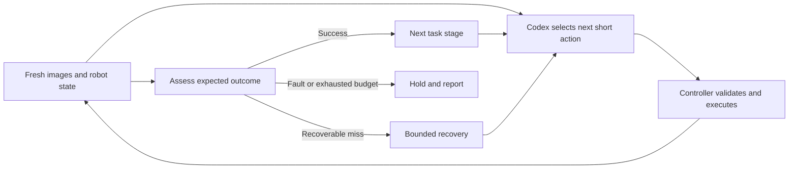

# Dynamic cleanup loop — staged plan

Status: session controller, stable visual sampling, local probing/alignment and target memory implemented. Physical delivery was validated after operator-approved telemetry-fault recovery; the first physical map was rejected. Successful local alignment and dynamic pickup remain unvalidated. Claude currently owns the arm; Codex's motion service is off. Current details are in [HANDOFF.md](../HANDOFF.md).
Owner: Codex. Branch: codex/so101-station.
Objective: Codex observes the real table, chooses short actions, checks results and recovers from ordinary misses. Add complexity one iteration at a time. No fixed pickup slots or calibration mat requirement.

Research update: [recent hackathon and hardware evidence](../coordination/RESEARCH-2026-11-21.md), reviewed 21 November. This informed local alignment, explicit verification and bounded recovery. The acceptance criteria below remain the target; implementation alone does not satisfy physical acceptance.

## What actually happened

- The operator taught pickup and drop joint poses. Full camera-to-table calibration was attempted but never validated.
- `scripts/taught_pickup.py` replayed planned motion between those poses, using fixed hardware identifiers and local plan files.
- A preflight rejected drift of the limp arm. A later approach stopped when wrist-flex settled about two ticks beyond the planner's margin, still within calibrated travel. We restored clearance and replanned with additional margin and joint interpolation.
- The first grasp closed fully without contact; the arm held rather than assuming success.
- Codex inspected overhead/wrist images and chose bounded Cartesian corrections through `scripts/visual_nudge.py`. There was no automatic visual controller choosing those corrections.
- `scripts/finish_pickup.py` grasped at the corrected position, lifted, paused for Codex's image check, carried to the taught drop and released. The after-image shows paper on the plastic cover and its source clear.
- One paper cleanup succeeded on the second grasp attempt. The wrapper was not picked. This is a demonstration, not a measured reliability rate.
- The robot was subsequently folded and all six motors explicitly turned off at that earlier checkpoint. Later trials superseded that state; consult HANDOFF.md and obtain fresh state only after hardware ownership is returned.

Evidence: logs/taught-pickup/result.json, pickup-1795286720969282000.json, drop-1795286795579142000.json, corrected-plan.json, second-lift-check.jpg, second-after-drop.jpg and folded-rest.jpg. Runtime evidence is local and ignored by Git.

## Proposed architecture

Codex selects objects, reasons about images and assesses outcomes. A persistent local controller owns Station, motion planning, execution, stop, operation state and retry budgets. Station remains the transport; the SO-101 adapter supplies its model, calibration and gripper semantics.

Keep three distinct loops:

1. Local servo tracking at the existing approximately 20 Hz command cadence. Stop, stale telemetry and following-error handling must not wait for Codex reasoning. This is software supervision, not a safety-rated hardware controller.
2. Visual alignment at observation/action cadence. Initially Codex chooses bounded steps; later a local tracker can correct a selected target between semantic decisions.
3. Task progression: select, approach, align, grasp, verify lift, carry, release, verify placement. Explicit state determines what is allowed next.

Return images with action results to avoid a new process and separate observation call for every correction. Preserve camera identity, resolution and individual frame/state timestamps; do not claim simultaneous cameras. Require post-action frames and reject excessive skew/staleness.

Keep a compact robot workspace containing operating instructions, coordinate frames/units, calibrated model, session configuration, current observation and action history. Borrow this organization from RoboHarness V2 while retaining our Station backend. CLI and MCP must call the same controller operations. Smoke-test the actual Codex entry point before expanding wrappers.

## Iteration 1 — package the proven loop

Deliver one persistent controller usable by CLI and MCP. Reuse the backend, executor, geometry, image packaging and existing expiry/stop checks. Put hardware identities and taught poses in session configuration. Resolve camera queues by camera identity rather than hardcoding a prefix from one Station boot.

Proposed tools (final contracts belong to implementation):

| Tool | Responsibility |
| --- | --- |
| observe | Both cameras, joint/gripper/torque state, observation ID and timestamps |
| act | One bounded action: nudge, open, grasp, lift, move to saved pose, release or park; references the observation used to decide |
| assess | Record Codex's visual outcome for the current stage, with evidence and observation ID |
| status | Stage, active action, motor state, retry count, last error and selected target |
| stop | Latched cancellation and measured-position hold; no automatic torque release |
| set_torque | Explicit hold/limp operation, separate from stopping; never implicit at startup |

Each request gets an action ID; repeating it returns its existing result rather than replaying motion. Only one writer executes at a time. Long actions expose progress and remain interruptible. Responses distinguish completed, empty_grasp, stale_observation, tracking_error, limit_margin, stopped and needs_operator, with observed values and next permitted actions. Callers should not parse exception prose to recover.

Separate execution outcome from task assessment in the response: a completed close/lift command can still have an empty or uncertain grasp. Include run/action/observation IDs, stage, attempt, calibration version, frame ages and assessment evidence. Assessments reference the active stage and fresh post-action observation; a stale assessment cannot authorize carry. Provide full images plus optional sharp target/gripper crops with camera and crop coordinates preserved.

Keep the taught cover pose and paper task in this iteration. Codex can still select visual nudges itself. Replace stdin GO/CARRY checkpoints with explicit action/assessment state. Contact is only a candidate grasp: require a short lift and visual confirmation before carry, then visual placement verification.

Use held / empty / uncertain for lift assessment. Inspect the object at the gripper and the overhead source patch together; an occluded source or stalled gripper alone is insufficient. Permit bounded reobservation for uncertainty. Treat successful release and stable presence on the cover as separate postconditions. Detect an already-satisfied stage from fresh evidence before issuing redundant motion.

Integrate live lessons: planning margins separated from tracking/quantization tolerances; checked current-pose transitions after manual guiding; gripper goals away from endpoints; consistent ownership/stop handling for every tool. Report a margin violation instead of silently widening limits.

Acceptance:

- Repeat one paper cleanup using only registered tools, without editing Python or hardcoding the corrected pickup XYZ.
- Every action returns a usable post-action observation and structured status tied to the correct action/stage.
- Offline tests cover stale IDs, duplicate actions, competing writers, stop during execution, empty grasp and restart without automatic motion.
- Record a separate physical smoke run. The robot stays off until an explicit hardware run is started.

Expected files: cleanup/backend.py, executor.py, harness.py, service.py, mcp_server.py, cli.py; small session/state modules as needed; examples, targeted tests and operating docs. Retire the ad hoc hardware scripts from the normal workflow only after parity is demonstrated. Keep their evidence.

## Iteration 2 — dynamic pickup in a validated region

Implemented building blocks: [stable local probing/alignment](../VISUAL_ALIGNMENT.md) and [target selection/location](../TARGETS.md). A selected wrist target can feed the probe directly by ID. Loss, expiry and reselection invalidate a target-bound probe. All positions from target memory remain image pixels; a valid grasp reference and physical alignment acceptance are still required.

Keep the drop fixed. Select paper from a fresh image and associate it with a target ID, grasp region, camera, observation and visibility. Use overhead vision for finding the object and wrist vision for final alignment. Start with arbitrary positions in a small validated reachable area, without pickup slots.

Estimate the local image-displacement versus robot-XY relationship from small known motions at checked clearance height; validate on a separate motion. Re-estimate or reject it after meaningful changes in camera, height, orientation or region. A ruler helps estimate scale but does not define the full coordinate transform or depth.

Implementation experiment: fit a 2×2 local command-to-pixel map using independent X/Y perturbations with a visible tracked feature and known grasp reference. Reject an ill-conditioned fit; use a damped inverse and per-step/cumulative bounds. Require two fresh in-band observations before descent, with thresholds derived from our images. Record commanded and observed displacement separately. Check for dead zone/backlash; any cumulative command strategy must retain live following-error, workspace and joint-limit checks.

Choose correction size from image error and uncertainty: larger in a proven clear corridor, smaller near contact. Check that error decreases; shrink or stop if the target is occluded, association changes or correction fails to converge. Descend in observed stages. Table/grasp heights remain explicit measured inputs; image alignment does not establish them or prove collision clearance.

Acceptance: five previously untaught paper placements in the region, aiming for at least four verified deliveries within two grasp attempts each. Log every attempt. No hand-taught pickup per placement. Report this as a small pilot, not a general success rate.

Keep all started trials in the results, including operator aborts. Report first-attempt and eventual success separately, along with false held/delivered assessments and cycle time. Compare the measured alignment loop against Codex-selected nudges before attributing improvement to it.

## Iteration 3 — bounded recovery

| Observed failure | Planned response | Limit |
| --- | --- | --- |
| Target moves before contact | Invalidate old plan, reacquire the same object, realign | Bound correction distance and time |
| Gripper closes empty | Open, lift to checked clearance, reobserve and correct | Two total grasp attempts per object |
| Contact but no object after lift | Failed grasp; locate object before retry | Same attempt budget |
| Object slips during carry | Hold and locate it; replan only from a feasible new scene | No blind continuation or automatic release |
| Occluded target/tips | Use another existing view or checked observation pose | Bound unsuccessful view changes |
| IK/reachability/margin failure | Reject target or plan a checked alternative from fresh state | Never enlarge physical limits to force a solution |
| Stale state, disconnect, following error | Cancel remaining stages, attempt hold if link/state permits, report | No automatic resume; hold may fail on link loss |
| Uncertain placement | Reobserve source, gripper and destination | No success count without evidence |

Recover ordinary visual misses within an already-authorized run without repeated operator questions. Return control for uncertain physical state, persistent faults or physical repositioning. Enforce run time and action budgets as well as grasp retries.

Resume from an observed checkpoint, not a remembered script line. Reacquire the object and change the failed grasp point or orientation within validated bounds; do not replay identical unsuccessful motion blindly. Track the same physical target across retries. Restart/disconnect invalidates pending assessments and requires fresh state before any continuation.

Acceptance: deliberately move paper between observations and induce an empty grasp. Recover within budget or stop with an accurate explanation. Inject transport/stop faults in offline tests before physical exercises.

## Iteration 4 — whole reachable workspace and multiple items

Add validated coarse camera-to-base grounding to approach objects outside the wrist view; wrist alignment refines it. Hand-guided correspondences or validated robot/camera observations can supply it without a printed mat. Document tested coverage: reachability and occlusion still constrain 'anywhere'.

Track/select one item, verify delivery, then rescan. Recognize the cover as a destination region and detect movement; a moved cover invalidates its cached drop pose. Image region alone is insufficient without grounded height and pose.

Add wrappers as a separate strategy once paper is repeatable. Find a pinchable edge; flat or ambiguous wrappers may need repositioning. Do not assume paper settings transfer.

Acceptance: untaught placements across the documented reachable workspace, then mixed paper/wrapper results reported separately. Test destination invalidation before relying on dynamic placement.

## Iteration 5 — speed and demo polish

Measure reasoning/perception, tool/transport, planning, motion and settling times separately. Remove repeated process startup, duplicate image calls and unnecessary tiny segments first. Coordinate travel/approach/grasp speed profiles with both controller and servo RAM settings. Preserve controlled contact and endpoint settling.

Optional later features: live selected-object/action overlays, verified cleanup count, before/after replay, skip-this-item and natural-language target selection. Defer learned policies, broad object classes and an elaborate dashboard.

## Next implementation slice

Start Iteration 1 only: persistent dual-camera observations, bounded actions with post-action images, structured outcomes/stop and paper-task stage state with lift verification. Keep the drop fixed. Evaluate before adding automatic alignment or more objects.

From the start, log observation/action IDs, stage, requested versus measured motion, images, timings, target identity, assessment, failure code and retry count. A failed run should be explainable without reconstructing the chat.

Save a compact JSONL event log plus full-resolution evidence. Offline replay should test stage transitions and assessment handling without connecting to Station. This tests controller logic; it does not validate grasp physics. Defer VLA training, additional agent frameworks and full simulator integration until the repeated physical baseline exposes a specific need.

## Implementation update — 21 November

Implemented `SessionHarness` alongside the original calibrated-table harness, with session CLI/MCP mode, dual-camera identity discovery, post-action frames, single writer, action deduplication, explicit torque operations and grasp/lift/placement gates. Operating instructions: [SESSION.md](../SESSION.md). The initial full suite passed 55 tests plus 15 subtests; after the requested speed change, 14 focused backend/session tests passed. Real stdio MCP discovery and both live images were verified.

The physical test exposed the expected limitation: the saved hover was several centimetres from the paper. Codex still selected each visual correction. The first grasp closed empty; the controller refused progression. After a changed grasp point, the second grasp passed a short lift check. This does not implement automatic visual alignment.

User feedback makes Iteration 2 the next priority: measure local motion response/backlash at a checked hover and execute a bounded local align loop, with Codex selecting/assessing targets. Do not interpret absent image motion as table contact or keep pushing against a stop. The loop needs a validated grasp reference and explicit table height. Nominal arm speed is now 0.45 rad/s with servo RAM speed 300; gripper closure remains controlled separately. Model/tool latency still limits overall cycle time.

Remaining first-slice refinements: finer typed legacy fault categories, bounded persistence/cache retention, automated replay runner and optional crop tools. The existing event log supports manual replay; no automatic learned verifier or full collision model is claimed.

Physical outcome update: second grasp passed visual lift assessment; carry was cancelled when all motor telemetry became stale. Telemetry recovered and images show paper still held near the cover. Delivery remains unverified, cleanup count zero. See HANDOFF.md for current state.

Final physical outcome: after explicit user direction and fresh held-object checks, remaining carry/release/retreat completed. Delivery was visually verified on the cover, source clear, counter=1. The transient freshness fault remains a reliability issue. User also requested a builder/operator split: root builds/tests; low-reasoning gpt-6-astra operator owns live actions.
